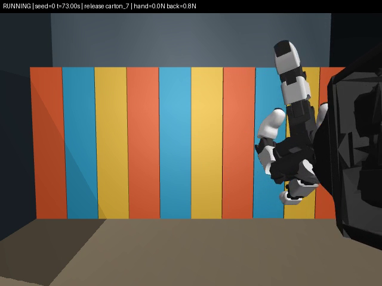

# Dense shelf insertion

This experimental task shares **10 mm or 5 mm total unused lateral width** over
an entire shelf row, including both wall gaps. Ten cartons occupy about half a
metre for seed 0. Initial targets divide this budget over eleven gaps; these are
initial geometric targets, not ten independent allowances.

```bash
abstract-stack dense-scene --seed 0 --objects 10 --initially-stocked 9 \
  --free-space 0.01 --output outputs/dense-10mm.json
abstract-stack build-scene --config outputs/dense-10mm.json --render \
  --output-dir outputs/dense-preview
abstract-stack solve --config outputs/dense-10mm.json \
  --output-dir outputs/dense-insertion
# Once evaluating video, add:
# --video --third-person-camera dense_front --fps 10
```

Use `--free-space 0.005` for the harder budget. Use `--initially-stocked 0` for
the full task. Nine prefilled cartons plus one insertion is a curriculum, not a
ten-object stocking success. Prefilled products remain under physics-step
tip/drop monitoring and receive no manipulation stage credit. Seeds determine
product dimensions, shelf depth/height and supply jitter; pass the same seed to
generation and execution when changing the default seed.

Batch campaigns declare the same curriculum up front, preserve process exits
and unknown outcomes, and keep each fresh scene in its own directory:

```bash
abstract-stack batch --seeds 0 1 2 --objects 10 --initially-stocked 9 \
  --free-space 0.005 --episode-timeout 300 --output-dir outputs/dense-campaign
```

The original `batch` command without `--free-space` retains its spacious task.

## Scene and control assumptions

The scene provides a coplanar transfer table flush with the shelf opening.
This is an explicit fixture aid. Reset-only shoulder/elbow parking avoids
initial collisions between the unmodified native robot and the denser fixtures.
The initial base is explicitly 4 cm closer to the shelf than the spacious bench;
the table legs are inset to clear the chassis. Exported XML includes a first
`scene_start` keyframe with the configured parked pose and native stationary
references; reset to keyframe 0 when loading it directly. Native joint references,
geometry, inertias, collision masks and gains remain unchanged.

The script picks a carton, aligns it on the empty shelf front using measured pose, unloads
the grasp, opens in place, withdraws, and plans a selected-finger push. It
searches bounded tilt, wrist-posture and approach alternatives with scratch
data. The supported-slide prediction translates the carton along -X after
closing the measured front-face gap, keeping its current Y/Z/orientation. This
forecast stops carton translation at geometric backstop contact while the tool
can take preload. This assumption checks predicted collisions; it is not an attachment or a dynamics
guarantee. Actual motion comes exclusively from native actuator targets and
MuJoCo contact. Contact-force feedback and measured wrist-load compensation
remain bounded and logged. Carton/carton contact has the same 25 N abort as the
robot/product guard.

## Acceptance and current status

Success requires the physical shelf goal, completed pick/place/final-position/
retreat evidence for **every scheduled manipulation**, and no transient tip or
drop. Final projected carton envelopes must fit the whole row for the configured
stability dwell: no individual negative gap or sum of negative gaps may exceed
0.2 mm. Numerical overlap is not counted as free space. Bounds and force aborts
are fixed while refining control.

Dense insertion is under development. Earlier tests exposed invalid fixture
clearance, grasp-release drift, wrist deflection and yaw-induced jams. A fresh
ten-carton/10 mm trial with nine prefilled products advanced the active carton
about 15 cm, then timed out before back contact. Subsequent 10 mm and 5 mm trials
completed all four stages for the single scheduled insertion, with no transient
tip/drop or final projected overlap. These are development cases, not a frozen
multi-scene success-rate study. See the [development report](reports/dense_insertion_followup.md).
The seed-0 two-insertion trial also completed all stages for both scheduled
cartons. Three fresh 5 mm scenes subsequently failed at transfer, pregrasp force,
and insertion dwell: **0/3** complete scenes under the preceding source
fingerprint. All three episode fingerprints match their campaign source;
the subsequent backstop-scope refinement is recorded separately. All failures
remain in the report. The table spans several controller variants and must not
be combined into an overall frozen-policy rate.

The all-ten-from-table trial failed its first transfer IK filter, after one
verified pick. Full stocking and robustness across fresh scenes remain open.
The separate spacious-shelf 40/40 result does not establish dense success.
Further tests stage on the shelf
front to shorten the ungrasped push and replan wrist posture when a corrected
target fails the unchanged IK filter. Initial base placement is explicit scene
configuration; this script does not drive the base during an episode.



The 10 mm seed-0 recording is at
`outputs/dense-ten-10mm-video-v1/videos/{third_person,first_person}.mp4`.
Both H.264 views are 640×480 at 10 fps with 774 encoded frames: 764 physics
frames plus 10 final paused frames. They render the same native physics states;
samples and actuator controls match the successful headless trial bit for bit.
The preview alone is not a success test.

Full traces, rejected plans, source fingerprints and failed outcomes stay in
ignored `outputs/`. Saved-state continuation probes are development diagnostics
and cannot replace fresh episodes in a success-rate denominator.

For cardboard deformation, see the separate [material investigation](cardboard_simulation.md).
Its panel indentation probes do not establish deformable grasping or insertion.
