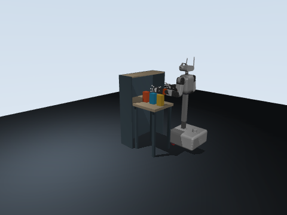
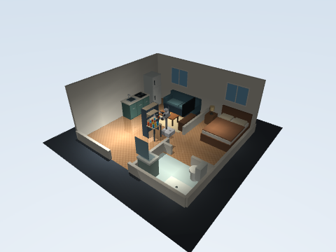

# Domain randomization and robustness evaluation

The first version, `stocking_geometry_dr_v1`, randomizes explicit procedural
scene configuration. It changes object counts/types, global carton dimensions,
shelf dimensions and levels, supply layout/jitter, and studio/house context.
It never edits a live model or MABEL geometry, inertias, limits or collision masks.
Geometric validity, native reset/hold validation and manipulation success are
separate results.

| Family | Objects | Shelf levels | Current teacher adapter |
| --- | --- | --- | --- |
| Carton bench | 2–6 cartons | 1 | Generic carton script; robustness unvalidated |
| Dense row | 2–10 cartons | 1 | Receding dense script; robustness unvalidated |
| Multiple shelves | 2–10 cartons | 2–3 | Not admitted by the current evaluation adapter |
| Small house | 2–10 mixed cartons/bottles | 2–3 | Not admitted by the current evaluation adapter |

Dense rows retain **5 or 10 mm total whole-row free width**, including both
walls. Other families have explicit larger gaps and are not dense-packing
benchmarks. Carton dimensions vary per scene; bottles retain the existing fixed
shape. Materials, masses, sensor noise/delay and native camera calibration are
not randomized in v1. Those need separate explicit configurations and evidence.




## Suites and reproducibility

```bash
.venv/bin/python scripts/domain_randomization.py generate \
  --output outputs/my-dr-suite --development 8 --heldout 12 \
  --development-seed 2026
```

Each case has a loadable `scene.json` and a hashed `context.json`, including
scene/reset seeds, family/factors and scheduled object names. These are
privileged provenance, not student observations. Layout generation validates
shelf/table fit and rejects invalid requests; it makes no reachability claim.
All objects begin on the supply table, with zero prefills.

Development seeds are reproducible. Held-out entropy is independent and private
by default, saved only in ignored outputs. Keep that split untouched during
tuning. Each split starts with an all-object evaluation ledger marked `not_run`;
no generated scene starts with successful stages or training eligibility.

The current suite is `outputs/domain-randomization-v1/`: 8 development cases and
12 private held-out cases. Held-out task evaluation and collection have not run.

## Native scene validation

```bash
MUJOCO_GL=egl MABEL_ROOT=third_party/open_mabel \
  flock /tmp/abstract-stack-render.lock .venv/bin/python \
  scripts/domain_randomization.py validate --suite outputs/my-dr-suite \
  --output outputs/my-dr-native-check --limit 4 --preview
```

The four development profiles compiled with native MABEL, passed initial
collision clearance and completed 0.2-second guarded holds. They contained
3 cartons/1 level, 10 dense-row cartons/1 level, 10 cartons/multiple levels,
and 10 mixed objects/2 levels in a house. All product/force guards ran at each
2 ms step with no incidents. Full compiled checkpoints and replay witnesses
are retained. This verifies scene construction and holding, **not stocking**.

See `outputs/domain-randomization-native-v1/report.json`; every scheduled case,
including a future rejection/crash, remains in its denominator.

## Frozen teacher evaluation

```bash
MABEL_ROOT=third_party/open_mabel flock /tmp/abstract-stack-render.lock \
  .venv/bin/python scripts/evaluate_domain_suite.py \
  --suite outputs/my-dr-suite --split development \
  --output outputs/my-dr-teacher-development --limit 1 --case-wall-seconds 180
```

The evaluator freezes one source bundle and mode profile, checks every case hash,
and supervises fresh native episodes independently. It reports pick, shelf
support, final positioning and retreat for **all scheduled objects**, clean
complete-scene success, process failures, unsupported domains and cases not run.
No episode can silently drop a hard object. Unsupported multi-shelf/mixed
teacher domains stay explicit zero-stage outcomes when scheduled; they are not
removed from a broad robustness denominator. This is an adapter limitation,
not evidence of physical unreachability.

The initial development baseline attempted one three-carton case and stopped
at `approach: contact outside bounded grasp region`. No pick or later stage was
verified. Seven development cases remain unrun. The current stack therefore
has **not demonstrated randomized task robustness**. The result is retained at
`outputs/domain-randomization-teacher-dev-v1/report.json`.

Held-out evaluation requires an explicit `--policy-source-ref` from an already
frozen development policy. Do not tune after seeing held-out results; create a
new private evaluation suite for a revised policy. Compare success/time/contact
and recovery results by family, object count, shelf count and density before
aggregating. Keep force limits and task tolerances fixed.

## Learning/data collection

The [LfD pipeline](learning_from_demonstration.md) now accepts explicit DR scene
and context files. Two bounded development fixtures collected 40 transitions,
42 snapshots and 84 raw first-/third-person images. Official LeRobot 0.7 export
and reload preserved pixels, nominal/applied actions, clocks, sensors, masks
and outcome labels. Sensor/proprioception semantics must match across episodes;
shape equality alone cannot justify combining different robots or taxel orders.

These are training-ineligible sensing fixtures. No successful manipulation
dataset, student training, upload or held-out collection has occurred. Diagnostic
teacher rollouts from the evaluator are not causal BC records. The next task is
to attach the causal recorder before every compensation path in the actual
stocking loop, then collect verified skill/task demonstrations on development
scenes. Teacher privileged context must remain outside student features.

Reports: `outputs/lfd-dr-pilot-v1/lfd_report.md` and
`outputs/lfd-dr-pilot-v1/sdk-roundtrip-v2/verified/audit.json`.
The original cache-related reload failure remains archived; the successful
retry used a writable local HF cache and the same exported dataset.

Integration checks: 169 focused controller, native-physics, checkpoint/source,
DR and LfD tests passed together. Pre-commit and offline wheel/sdist builds
passed. Logs are in `outputs/final-dr-lfd-validation-v1/`. These checks do not
replace a complete frozen-policy manipulation campaign.
