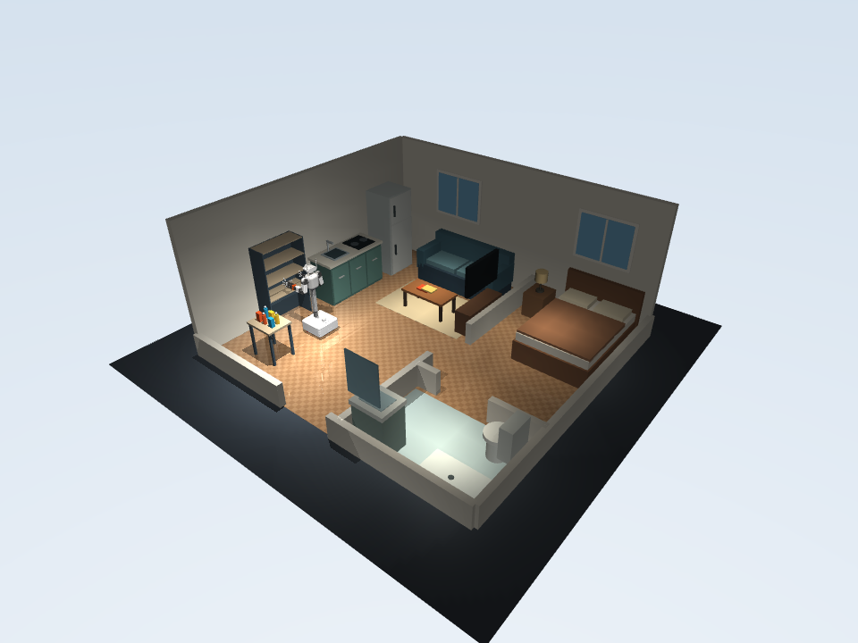
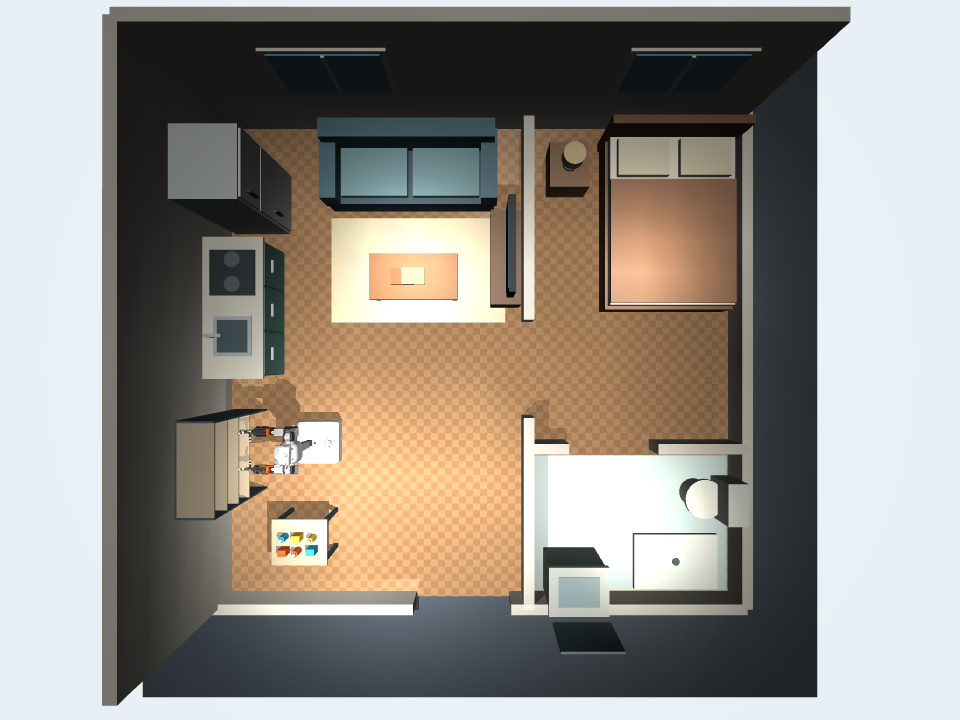

# MABEL in a small house

The `house` scene places the full MABEL model and shelf-stocking task inside a
furnished 6.0 × 5.6 m house. It has an open kitchen/living area, a bedroom, and
a bathroom, with open passages connecting them. The starter shelf sits against
the kitchen's west wall, the six rigid cartons/bottles start on a nearby work
table, and MABEL starts facing the shelf.



## Launch

```bash
source .venv/bin/activate

# Download MABEL if missing, export the scene, and render wide/room views.
abstract-stack build-scene --scene house --fetch-mabel --render \
  --output-dir outputs/house

# Open the house in the native MuJoCo viewer.
abstract-stack sim --scene house

# Start at a closer kitchen view, or inspect the floor plan.
abstract-stack sim --scene house --camera kitchen
abstract-stack sim --scene house --camera house_overhead

# Run physics without a display, or serve the same scene through Emet.
abstract-stack sim --scene house --headless --steps 500
abstract-stack serve --scene house --headless
```

`--scene house_tight` uses the same house with a narrower shelf, 18 total
products, 12 already on the shelf, and six remaining on the work table. The
prefilled products stay dynamic and can be rearranged or knocked over. Use
`--robot none` to work on the room geometry without loading MABEL.

## Layout and objects



| Area | Included fixtures |
| --- | --- |
| Kitchen | Three-level task shelf, supply table, counter and cabinets, sink/tap, two-burner hob and refrigerator. |
| Living area | Sofa, cushions, rug, coffee table, books, TV and console. |
| Bedroom | Bed frame, mattress, duvet, pillows, nightstand and lamp. |
| Bathroom | Tiled floor finish, vanity/basin, mirror, shower tray and toilet. |

Architecture and furniture are fixed MuJoCo geometry. The task cartons and
bottles are free rigid bodies with physical contacts and the existing stocking
evaluation. Books, cushions and the other furnishings are fixed decoration,
not additional manipulation targets. Windows are decorative surfaces on solid
walls. Doorways are open; articulated doors, drawers, plumbing and appliances
are not implemented.

House wall centre-lines span X = -3.0 to +3.0 m and Y = -2.8 to +2.8 m. Walls
are 0.12 m thick and 2.6 m tall. All interior/exterior doorways have 2.15 m of
vertical clearance; the entrance and bedroom openings are 1.10 m wide, and the
bathroom opening is 1.00 m wide. Floors are flush with the existing z=0 physics
ground. Visible flooring and rugs do not add overlapping ground contacts.

The kitchen and living area share open floor space. The central passage to the
bedroom and the entrance are kept clear of the stock table and living-room
furniture in the supplied presets. This geometry provides a starting navigation
environment; doorway clearance and idle stability do not establish successful
whole-body navigation or manipulation policies.

## Views and cutaways

| Camera | View |
| --- | --- |
| `overview` | Wide house view with foreground walls/roof cut away. |
| `house_overhead` | Top-down floor plan with the same cutaway. |
| `kitchen` | Interior kitchen, MABEL, work table and shelf. |
| `living_room`, `bedroom`, `bathroom` | Interior views of each furnished area. |
| `task_overview`, `shelf_front`, `supply_overhead` | Close views for stocking setup. |

MABEL's nine onboard cameras remain in the model. Offscreen renders of room and
robot cameras include the full architecture. The ceiling and selected upper
walls use MuJoCo geometry group **5**; only `overview` and `house_overhead`
hide that group. Their collision flags remain enabled in every view.

The native viewer initializes group 5 visibility for the requested starting
camera. When switching cameras manually, use its **Rendering → Geom groups**
controls to show group 5 for an interior view or hide it for a cutaway. The raw
export also contains the full physical walls and roof: external rendering tools
must select the cutaway themselves if desired.

## Export and customize

The scene bundle contains episode-start `scene.xml`, `manifest.json`, and, with
`--render`, eight preview images: `overview`, `house_overhead`, `kitchen`,
`living_room`, `bedroom`, `bathroom`, `shelf_front`, and `supply_overhead`.
The manifest includes house bounds, semantic room rectangles, door locations,
MABEL's actual source revision, configuration, initial product poses and
controls, and settled task metrics. Room rectangles describe the layout; they
are not a collision-free navigation map.

```bash
mkdir -p configs
cp src/abstract_stack/configs/house.json configs/my_house.json
# Edit the copied task/robot placement, then:
abstract-stack build-scene --config configs/my_house.json --render \
  --output-dir outputs/my-house
```

`environment: "small_house"` enables the house architecture. The other fields
use the [existing shelf configuration](scene_setup.md#edit-the-layout), with
world-frame shelf, table and robot positions. The house preset changes these
positions to put the task in the kitchen. The house footprint, partitions and
furniture are defined in `src/abstract_stack/house.py`; the model uses local
primitives and needs no extra house asset download. Custom placements outside
the exterior walls or above the ceiling are rejected. Check custom placements
against the interior furniture and partitions before collecting data.

The existing [MABEL import instructions](scene_setup.md#import-mabel) still
apply, including `MABEL_ROOT`, `--mabel-root`, actuator units and nonzero lift
hold at reset. The robot remains dynamic; the house adds no robot welds or
changes to its actuator count. Exported robot meshes use absolute paths, so
keep the upstream checkout available when reopening the XML.

## Validation

House tests check physical wall collisions, open doorway rays, product
settling, MABEL spawn collisions and upright idle stability, plus reloadable
exports and house metadata. Rendered wide, overhead and interior views provide
visual checks of the generated layout. Stocking and navigation autonomy remain
future work.

```bash
uv run pytest
# If a ROS-sourced shell injects unrelated pytest plugins:
PYTEST_DISABLE_PLUGIN_AUTOLOAD=1 uv run pytest
```
