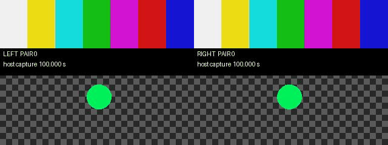

# Paired-JPEG diagnostic preview



This four-second animation is generated by the actual #21 `synthetic_pair` →
`encode_pair` → QTP1 packet → `unpack_pair(decode=True)` path. Both eyes share the
pair ID/capture timestamp and motion, with opposing disparity. It demonstrates
framing/eye identity and decoded pixels. It is **synthetic**, not a Quest video,
a native-camera render, a performance measurement or a robot-control result.

Settings:40 frames,10 fps playback,320x240 RGB8 per eye, JPEG quality75,4:2:0,
calibration generation0 and fixed diagnostic capture timestamps100.0–103.9 s.
The header's synthetic simulation-time progression is unchanged from the source;
playback rate is chosen for a compact preview rather than simulation timing.
Generator/runtime: Python3.11.15, NumPy1.26.4, Pillow13.0.0; source implementation
is `src/abstract_stack/teleop/video.py` from commit`a1fa8f5`.
No device, native model or physics stepping is used by this generator.

Reproduce from the repository root:

```sh
PYTHONPATH=src python docs/quest_teleop/media/head_video/generate_preview.py
```

The generator validates each packet/pair ID and the final40-frame image. The
companion MP4 contains the same frames, encoded with ffmpeg H.264 solely for
review playback; it does **not** introduce H.264 into the teleop protocol:

```sh
ffmpeg -y -i docs/quest_teleop/media/head_video/paired-jpeg.gif \
  -an -c:v libx264 -pix_fmt yuv420p -movflags +faststart \
  docs/quest_teleop/media/head_video/paired-jpeg.mp4
```

For actual device images, see the [viewer PR#34](https://github.com/cpaxton/abstract_stack/pull/34).
Native-camera, clock/latency and remaining validation evidence is described in
[video.md](../../video.md) and PR#35; animation smoothness is not timing evidence.
