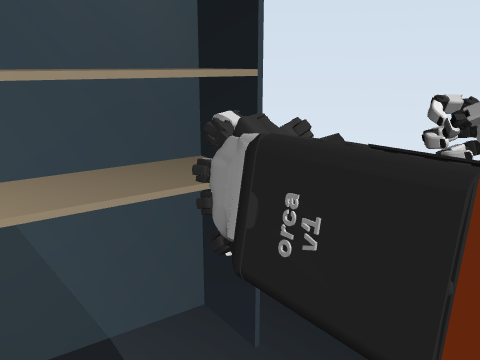
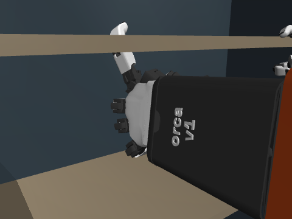

# Native finger characterization previews

Actual MuJoCo wrist-camera renders after native actuator commands and physics,
from the development probe on2026-11-17. These are not Quest images or a grasp
success demonstration. The source images are copied unchanged; full source,
model/settings/contact traces remain in ignored outputs/quest-retarget-fingers.

Seed0, zero products, explicit shelf front_x−1.4 m, unchanged native robot and
contacts. Both hands respond to commands, with lag and self-contact error still
present. A closed command is not an accurate measured posture or held object.

Same native model with default shelf front_x−0.62 m. The shelf obstructs finger
motion; this is retained failure evidence. The isolated probe intentionally
characterizes native response without the final #20/#17 collision gate and must
not be used as an integrated teleoperation entry point. No hidden attachments,
pose corrections or collision disabling were used.

Capture uses the optional --render mode of scripts/probe_quest_retarget_fingers.py
(Python3.11.15, MuJoCo3.17.0, NumPy1.26.4; native model revision
`d0181f04025c06e1790b7ab41fe44d602cc2ee5b`, timestep0.002/frame_skip10).
The development renders precede the applied-reference-feedback extension; their
commands/contact measurements are described in [retarget_fingers.md](../../retarget_fingers.md),
not presented as a frozen final-code or live-device acceptance run.
