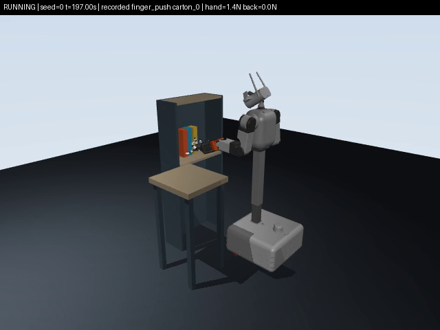

# Adjacent insertion toward a complete shelf

Development status, 2026-11-18: one fresh tight three-carton episode completes
every stage. Four-carton and ten-carton completion remain open. These are
successive controller-development trials on seed 0, not a frozen-policy success
rate. The [trial ledger](adjacent_insertion_development.json) includes every
fresh episode through `tight-four-04` and `tight-ten-04`, including failed reset
construction. Checkpoint retries are separate and earn zero fresh task credit.



This frame is at replay time 197 s. The two full MP4s are retained under
`outputs/adjacent-insertion-v1/tight-three-14-video-gpu/videos/`. The native
actuator replay matches the recorded terminal integration state bit-for-bit;
rendering leaves the state unchanged. GPU rendering took 75.276 wall seconds
at 8 fps, versus an interrupted software-only attempt preserved separately.

| Scene | Pick / shelf placement / final position / retreat | Result |
|---|---|---|
| `tight-three-14` | 3 / 3 / 3 / 3 | Complete; zero prefills or tip/drop incidents |
| `tight-four-01`, `tight-four-04` | 3 / 3 / 2 / 2 | Third front alignment blocked |
| `tight-ten-03` | 1 / 1 / 0 / 0 | First front alignment exhausts bounded correction |

The three-carton success took **208.198 simulated seconds**, 158.019 wall
seconds, with an **11.249 N** robot/product peak. Its source content ID is
`1331b20426414a29042e0b4a5b0134c5c191e5a94c11386a221c42032e77e197`.
It has 3 mm target inter-carton gaps and spacious walls; it does **not** meet
the ten-carton whole-row free-space task. Its first carton uses the original
grasped slide, and the adjacent cartons use released selected-finger insertion.

## Integrated behavior

`StockingScript` and `DenseStockingScript` now share the same release, native
finger-posture planning and insertion skill. The opt-in `--ungrasped-insertion`
mode selects a released push beside completed neighbors; dense rows use it for
every carton. It restores the wrapping hand before the next pickup.

Neighbor-clear front staging is chosen during carried transfer. Grasp opening
starts from the applied finger reference and holds the arm nominal pose instead
of chasing a slipping carton. Pusher reachability screens require a 2 mm
controller goal, and native base relocations are rechecked before approach.
After first back contact, bounded short native forecasts square the carton;
load-aware withdrawal measures release and clearance at every physics step.
Final nominal/applied references and selected forecast metadata remain distinct.

### Paired-pad follow-up

The additional `--paired-finger-insertion` flag uses the native index and ring
IP pads for every carton, including the first. Index/ring abduction targets of
+0.15/-0.15 rad put both pads inside a 50 mm carton face; the middle and pinky
fold at native MCP/PIP references of 1.5 rad. Both predicted geometry and actual
actuator commands use that posture. The original grasp abductions are restored
before the next pickup. Native model geometry and gains are unchanged.

Single-finger yaw feedback shifts the contact lever sideways. Applying that
rule to two pads caused lateral drift and neighbor collisions. The paired mode
instead keeps its midpoint inside the measured carton face and controls the
actual pad-plane yaw, including native finger-servo deflection. Orientation
reference bias is bounded to three degrees. Short guarded forecasts then refine
the supported backstop contact, with the unchanged measured 0.4 N/0.12 s dwell
and 0.15 degree yaw gate. A near-backstop staging transition does not itself
verify contact; the native refinement must do so.

Opening near a sidewall now screens partial thumb extension against both the
wall and the next 20 mm departure. Curling a thumb merely to clear a wall tipped
the carton in a retained failed probe. Holding a hooked thumb prevented tipping
but blocked retreat. A checked -0.4 rad PIP/DIP opening completes the difficult
ten-carton entry. Full native release/retreat forecasts own independent data and
controller state and do not modify the live scene or earn task credit.

`ten-thumb-opening-04` completed that isolated skill at -0.02373 degrees yaw,
but drifted 8.56 mm sideways. With actual pad-plane feedback,
`ten-centered-insert-01` completes at -0.00231 degrees and 0.639 mm lateral error;
both have zero tip/drop incidents and zero fresh-task credit. Earlier paired
probes reached about 15.44 N robot/product normal force despite a 2 N commanded
backstop target: a setpoint is not the measured force or the 25 N abort guard.

`tight-four-13` picks and supports all four cartons and completes three full
stocks. The fourth push times out, moving about 97 mm of its approximately
124 mm route. A 1.875 N normal target nearly balances board friction. The next
declared development profile tests a 2.5 N push target with the 25 N guards
fixed. The first ten-carton attempt with pad-plane feedback retains the earlier
1.875 N target in its immutable controller snapshot. These are successive
development policies, not a frozen success rate.

All trials retain the 25 N force guards, original collision admission and task
criteria. Carton-pair normals and carton-sidewall normals are summed before
force admission. Every product is monitored for transient tips and drops at
each native step. The dense final-envelope limits remain 0.2 mm individual and
total overlap. No attachment, contact disabling, external product force or live
pose correction is used.

## Development failures and next gates

The full ledger retains thirteen unsuccessful tight-three trials before the
complete episode. They expose rejected pusher paths, release-induced yaw,
tracking/force aborts, insufficient alignment and contact dwell, a base-arrival
failure and failed withdrawal. A saved-state release recovery passed at
0.138 degrees final yaw; a separate final-withdrawal retry passed at 0.144
degrees. These are narrow margins and zero new episode credit.

The four-carton alignment rejection includes `lift_base`/`body_mount` collision
at a nearly retracted lift. A scratch geometry scan finds about 19.4 mm
penetration at zero aggregate extension and 10.6 mm clearance at 30 mm.
Current opt-in planning reserves at least 30 mm lift extension without changing
upstream native limits or masks. That prevents the collision, but the next
fresh trial still fails object alignment. A carton-centered yaw reference is
being tested; it is not validated by the earlier successful three-carton run.

The experimental `--payload-wrist-compensation` adapter reuses the existing
measured-wrist feedback, reserved references and coupled compensated-geometry
guard. Its four/ten-carton trials fail during loaded clearance. It is not the
selected baseline or a validated complete pick/carry/place policy.

The ten-carton preset has **0.51 m inside width for ten 0.05 m cartons**, hence
10 mm total free width shared by eleven wall/inter-carton gaps. Its larger
supply table is shifted away from the robot to avoid initial leg/product
intersection. The idle right shoulder starts at a documented 0.5 rad abduction
to clear the panel; this is reset configuration, not a model change. Both
rejected earlier reset configurations remain in the ledger. Rear-gap variation,
5 mm total row space and private held-out testing remain future gates.

## Reproduction

For current development, with downloaded native MABEL assets:

```bash
PYTHONDONTWRITEBYTECODE=1 MABEL_ROOT="$PWD/third_party/open_mabel" \
  flock /tmp/abstract-stack-render.lock .venv/bin/python scripts/run_stocking_case.py \
  --config configs/scenes/tight_four_cartons.json \
  --output outputs/my-fresh-four --wall-seconds 450 -- \
  --grasp-skill --base-reposition --ungrasped-insertion \
  --paired-finger-insertion \
  --control-config configs/controllers/adjacent_insertion.json --record-skill-starts
```

Use `tight_ten_cartons.json` and a declared 900-second wall budget for the full
row. Each run captures source bytes into the shared source store, records the
scene, seed, effective controller and native model revision, and supervises its
process. Current code differs from historical trials: reproduce those with
their recorded source content IDs and manifests, not current defaults.
The current ten-carton preset declares a 1,800-second simulation limit; its
supervisor retains the 900-second wall budget. Earlier attempts used a
900-second simulation limit. Completion time remains an evaluation metric.

`scripts/probe_front_release.py` restores front-release, loaded-transfer or
selected-finger withdrawal entries with explicit nominal state. It runs under
a 90-second wall budget and always reports zero fresh task credit. This is a
diagnostic tool, not a causal LfD collection pipeline. Full traces, checkpoints
and failed artifacts stay in ignored `outputs/adjacent-insertion-v1/`.

The full regression attempt initially stopped at 279 passed and one outdated
guard-test dispatch failure after moving the shared skill. The test now invokes
the shared native summed-force guard directly. The next full suite passed
446 tests in 241.43 s; later focused motion/navigation checks passed 48 tests,
and updated native contracts/guards passed 34. Packaging and tracked-file
pre-commit checks pass. These checks do not replace the still-open full-shelf
and native process-stability acceptance gates.
