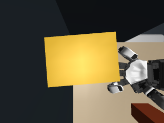
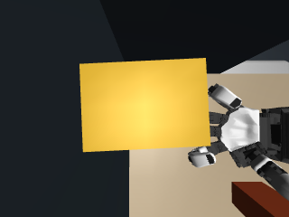

# Checkpoint and focus-bank development

A compiled MABEL checkpoint reproduces 50 native physics steps bit for bit in
a fresh process, including integration state, body transforms, accelerations,
constraint forces and contact records. Five focus states were then captured
from recorded actuator replay. No fresh manipulation credit is claimed.

The [workflow guide](../sim_checkpoints.md) gives capture, verification, gallery
and comparison commands. The [numeric ledger](checkpoint_focus_development.json)
retains source fingerprints, bank measurements, fresh-process outcomes and all
ten scheduled comparison results. Full sources/models/controls/images remain
in ignored `outputs/`.

## Native evidence and limitations

The initial ordinary capture at `outputs/checkpoints-v1/carton8-stalled/`
segfaulted while importing MuJoCo's native `_specs` module, before model
construction. A separate GDB capture with a 45-second budget completed in
2.67 s without reproducing the fault. GDB was used to seek a native backtrace;
it did not identify or fix the cause. That capture is retained separately at
`outputs/checkpoints-v1/gdb-capture/`.

Ordinary fresh-process verification subsequently passed in 0.67 s, with zero
difference in every compared native field across 50 steps at 2 ms. This loads
the MJB directly and does not recompile MJCF. The upstream model is unchanged;
the MuJoCo 3.17.0 / NumPy 1.26.4 runtime is recorded. A lightweight fixture also
verifies activation, userdata, mocap and separate nominal/applied references,
and relocation after deleting the fixture's original external texture.

All three archived control trajectories reached their original terminal
integration states bit for bit before their selected frames were emitted.
The final gallery is `outputs/compliance-focus-v3/index.html`; it has five
checkpoints and four camera views per state. The final build took 17.00 s.
Earlier camera-only gallery variants remain retained as v1/v2.

All five states passed model/state/force replay verification in the bank worker.
A separately scheduled five-process check of v2 passed four cases; the
`yawed_back_contact` process segfaulted during native import before reading its
checkpoint. That fifth outcome remains **unknown**, not a replay mismatch or a
passing retry. Logs/results remain in
`outputs/compliance-focus-v2-fresh-verification/`. Earlier successful loads do
not close the native process-stability gate.

The scene import uses a historical XML/state pair; the original live MJB was
not available. Its initial state and three exact archived terminal replays
support this reconstruction, but do not retroactively prove binary identity
with every original process setting. Newly captured checkpoints preserve their
actual compiled models.

## Last-millimeter continuation

Starting directly from `approaching_backstop`, one 100 ms native prefix moved
the carton another 0.271 mm and reached 0.708 N backstop contact. Combined
robot/product load peaked at 2.33 N, with no incident. Parent time was 3.32 s;
no pickup or two-second insertion prefix was replayed. A new terminal checkpoint
was saved with controller/monitor memory. Full artifacts remain at
`outputs/checkpoints-v1/resumed-last-mm/`.

This is first contact, not sustained squared contact, release or retreat.
The controller remains slower than real time. Replanning can deliberately change
the policy after restoring the same physical state; that is distinct from
claiming bit-identical closed-loop continuation for arbitrary Python controllers.

## Fixed prefix comparison

All ten scheduled runs completed: two 100 ms decisions for held targets and
compliant control at each of five states. Parent wall time summed to 32.87 s;
the experiment adds two simulated seconds in total. No new tip/drop incident
occurred. **None passed the existing squared-contact dwell.**

| State | Held yaw reduction | Compliant yaw reduction |
| --- | --- | --- |
| Stalled before backstop | -0.00008 deg | -0.09455 deg |
| Approaching backstop | 0.11420 deg | 0.17479 deg |
| First back contact | 0.03948 deg | 0.11509 deg |
| Yawed back contact | 0.02516 deg | 0.03962 deg |
| Bound-limited squaring | 0.02828 deg | 0.02828 deg |

Negative reduction means yaw grew. Approaching the backstop and squaring are
different phases; advancing a free carton need not reduce yaw immediately.
The bound-limited state behaves identically to held targets, supporting a
checked unload/reposition/re-contact primitive as the next change.

The original report's force peaks include checkpoint history: for example the
bound-limited state's cumulative 4.70 N peak predates these short prefixes.
Those values are not evidence of prefix-only force improvement. All raw runs
remain unchanged at `outputs/compliance-focus-comparison-v1/`; the runner now
labels the cumulative scope explicitly. The controller source was frozen once
for the entire comparison. This is a development comparison, not a held-out
success rate or ten-carton acceptance result.

## Native previews

First back contact and the later bound-limited state, using a debug-only camera:

