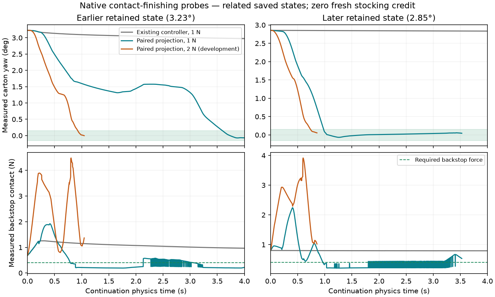

# Bounded references for compliant contact finishing

The opt-in paired-reference projection removes a numerical stall in the retained
contact controller. The original 1 N controller fails the contact-dwell gate in
both saved states; projection passes one of two within the same four-second
budget and squares the other. Separate development probes at 2 N pass contact
dwell from both states in 0.856–1.046 simulated seconds. **Release and retreat
remain failed.** These are related checkpoint continuations, not fresh stocks,
independent held-out scenes or a whole-shelf success rate.



The green yaw band is +/-0.15 degrees. Backstop force must also exceed 0.4 N
with upright shelf support for 120 ms; entering the yaw band alone is insufficient.
The orange curves are separate force-target development probes, not the matched
1 N comparison. Traces stop at contact completion, before any withdrawal.

## Controller change

Previously, small nominal Cartesian corrections could move the compensated
servo attractor a few micrometres outside its saved envelope. Those proposals
were rejected and the held-target baseline repeatedly won. Extending the run
did not resolve this local proposal failure.

`ReferenceEnvelope` projects the proposed joint increment against **both**
nominal FK and virtual applied-reference FK. It preserves their compensation
offset, native joint limits, existing nominal planning ranges, rate bounds and
ramped wrist postures. NumPy Dykstra projection uses at most 128 iterations per
linearization and four FK linearizations. A 1 micrometre inward margin narrows
the corridor; no acceptance tolerance is expanded. Nonconvergence rejects the
proposal. Final exact FK, Cartesian speed, angular speed and coupled applied
arm/finger collision checks still run after projection. Some proposals still
fail those checks and are retained in the evidence.

This is a scratch-only planning change. Execution remains native actuator
targets with 2 ms MuJoCo stepping and monitoring of every product. Model geometry,
inertia, gains, collision masks, external forces and the 25 N abort guard are
unchanged. `--project-reference-bounds` is opt-in. The same bounded Cartesian
prediction wrapper can accept an envelope from another contact skill, but the
withdrawal controller does not yet use this projection.

The runner now measures nominal-FK execution tracking during held-target
prefixes too. A known nominal reference remains distinct from an applied servo
target even when the selected candidate holds that applied target.

## All scheduled evidence

Full artifacts are in `outputs/compliance-reference-v1/`; the
[JSON ledger](compliance_reference_projection.json) retains all ten scheduled
continuations, exact commands, source IDs, input references, raw artifact hashes,
failures, incident histories and cumulative/local force distinctions. All ten
processes exited 0 within their declared wall budgets; failed physical stages
remain failures. No failed run was discarded.

The matched suite schedules four continuations from two related development
states. Each allows 20 decisions, ten proposals per decision, a guarded shortlist
of four, 0.2 s forecasts/prefixes and a 90 s process budget. Both variants use
the same 1 N target, exact starting state, controller source and task criteria.

| Start / controller | Physics time | Final yaw | Local peak hand load | Contact dwell |
| --- | ---: | ---: | ---: | --- |
| v10 / existing | 4.000 s | 2.974 deg | 1.934 N | Failed |
| v10 / projected | 4.000 s | -0.070 deg | 2.624 N | Failed: insufficient backstop force |
| v11 / existing | 4.000 s | 2.834 deg | 1.292 N | Failed |
| v11 / projected | 3.526 s | 0.046 deg | 3.128 N | Passed |

Measured execution tracking peaks are 12.82/14.00 mm for v10 existing/projected
and 12.44/13.83 mm for v11. These are measured physical-tool errors relative to
nominal FK at the measured base, separate from predicted IK residuals. Projection
does not solve tracking/load-compensation error.

The bounded follow-ups preserve the same geometry and acceptance criteria:

| Probe | Outcome |
| --- | --- |
| Initial v11 pair | Existing failed at 4 s; projection passed at 3.526 s; repeated by the final matched suite |
| v10 projected, 1 N, 8 s | Still failed contact dwell despite 0.075 deg final yaw; duration alone is insufficient |
| v10 projected, 2 N | Passed contact dwell at 1.046 s; -0.00369 deg yaw; 5.438 N local hand peak |
| v11 projected, 2 N, then withdraw | Passed contact dwell at 0.856 s; unload failed after another 3 s; 4.818 N local hand peak over the combined probe |
| v11 1 N contact checkpoint, withdraw only | Unload failed after 3 s; 0.285 N residual robot/product load exceeds the unchanged 0.2 N release criterion |

The 2 N runs change a force target on development cases, not a force abort limit
or success tolerance. They do not establish held-out robustness or justify
promoting a default. No tip/drop incidents, non-hand product contact or robot
fixture contact were recorded in these continuations. Monitor histories retain
parent peaks; for example the 4.160 N inherited robot/product peak in the matched
suite is not its local suffix peak. The ledger reports both explicitly.

There are ten scene products and one declared initial prefill. The tested suffix
acts on `carton_9`; earlier manipulations and fixture construction are inherited.
No fresh picks, shelf placements, final whole-task positions or complete retreats
are credited by this study. The parent fixture's earlier whole-row-fit warning
also remains in its provenance; local squaring does not certify a feasible full
row layout.

## Release blocker and replay

The unload controller keeps frozen applied-minus-nominal compensation while
contact load disappears. It moves only 1.20 mm outward and 9.29 mm upward in the
1 N release probe, versus a 6 mm outward goal; peak measured nominal tracking
error grows to 32.2 mm. Neither force-based release nor the outward goal passes
within three seconds. This suggests testing refreshed load compensation and
measured Cartesian/force feedback during unloading, with the same release and
motion guards. Increasing contact force alone did not repair release.

`outputs/compliance-reference-v1/video/overview.mp4` shows the 1 N v11 contact
finish followed by the failed unload, with third-person, robot-mounted first-person
and overhead debug views. Both segment terminal integration states replay
bit-for-bit. The replay preserves physical state during rendering and earns no
new task credit.

## Provenance and reproduction

The final matched suite and all follow-ups use frozen source content ID
`11be626d7a6325d7d68c2df8cd332cc6b73c71772ec6c4cac31557d5f408c822`,
Git base `93e1929` plus captured changes. Native MABEL revision is
`d0181f04025c06e1790b7ab41fe44d602cc2ee5b`, MuJoCo 3.17.0, NumPy 1.26.4,
scene seed 0 and a 2 ms physics step. The initial pair has separate source IDs
recorded in the ledger. Checkpoints retain controller mode flags and the exact
compiled model; no source bundle or historical outcome was rewritten.

With retained checkpoints available, reproduce the projected v11 case in a
fresh directory:

```bash
PYTHONDONTWRITEBYTECODE=1 MABEL_ROOT="$PWD/third_party/open_mabel" \
  flock /tmp/abstract-stack-render.lock .venv/bin/python \
  scripts/probe_compliant_lookahead.py \
  --checkpoint outputs/continuous-next-stock-v11-fine-square/terminal-checkpoint \
  --output outputs/my-reference-projection \
  --require-dwell --square-feedback --front-face-sweep --normal-target 1 \
  --horizon 0.2 --candidates 10 --shortlist 4 --execute-prefix 0.2 \
  --replans 20 --wall-seconds 90 --project-reference-bounds --save-checkpoint
```

Omit `--project-reference-bounds` for the existing controller. Substitute the
v10 checkpoint for the earlier state. The force-target probe uses
`--normal-target 2`; `--withdraw` adds the separate release test. Current commands
capture current source; historical replay requires the recorded immutable source.

Validation: 40 focused tests passed, including native MABEL scratch immutability,
dual-reference bounds, posture preservation, infeasible-search rejection,
contact forecasts and withdrawal guards. Pre-commit and wheel/sdist build passed.
This is targeted validation; the historical full-suite native process-stability
gate and fresh whole-task acceptance remain open.

## Emet reuse

The installed Emet dependency is revision
`ee3f1c9461c6e18654143a04461172bd175ffa62`. Navigation already reuses its A*.
Its `TaskProvider`/`TaskSession` snapshot, execute and measured-effect contracts
and physical pick/place executor are useful outer-skill interfaces. The latter
requires a MABEL backend with native joint execution and measured retention;
the separate kinematic executor's attachment/pose shortcuts cannot provide
physical success evidence. No ready contact-admittance controller was found
in the inspected installed controller/motion modules, so this contact correction
stays local. No upstream issue or PR was filed for this change.
