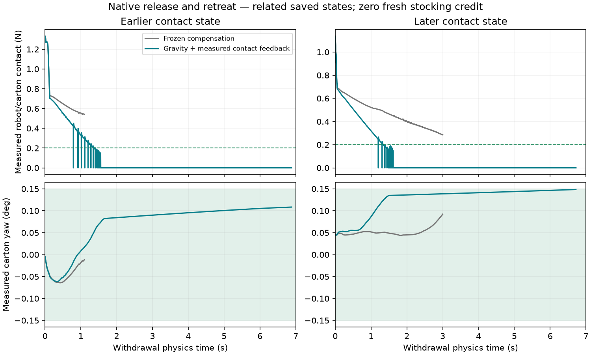

# Load-aware release and retreat

Refreshed native gravity and measured wrist contact-torque compensation complete
release and retreat from both tested contact checkpoints. Frozen compensation
fails from both. The combined square–release–retreat controller also passes both
related development states in 7.704–7.926 simulated seconds. **These are saved-state
continuations with zero fresh pick or full-stocking credit.** Neither held-out
robustness nor promotion into the complete stocking script is established.



The dashed line is the unchanged 0.2 N release-force criterion; the green yaw
band is the unchanged +/-0.15 degree criterion. Successful release additionally
requires supported, upright, slow object motion for 120 ms and verified hand
clearance. The shorter gray traces end at their recorded failures.

## Diagnosis and control

At the v11 contact checkpoint, wrist compensation is 0.41294 rad, while robot
gravity alone requires about 0.16697 rad through the native wrist's kp=1 servo.
The difference includes stale contact-load compensation. During the old unload,
wrist tracking error grows from 0.0846 to 0.1800 rad and peak nominal-FK tool error
reaches 32.20 mm. The hand moves only 1.20 mm outward and 9.29 mm upward; residual
robot/product contact remains 0.285 N after the three-second unload budget.

`WithdrawalTracker` reuses `MabelController` with the explicitly known nominal
left-arm/wrist/lift subset. It refreshes robot gravity in scratch data, retains
the tracker's wrist velocity damping and adds the negative measured contact
reaction torque about the wrist. Contact torque includes normal, friction and
contact-moment contributions from native `mj_contactForce`, with a documented
world-frame lever arm and joint-axis sign. Tests compare both geometry orders
against MuJoCo's generalized constraint torque.

The extra wrist holding effort is bounded to +/-0.3 Nm and total wrist offset to
0.5 rad, matching the existing dense-contact controller's explicit limits.
Unknown nominal dimensions, the other arm, wheels and native finger commands
are held. After each executed prefix, the tracker acknowledges the actual
executed nominal/applied pair; rejected or partial commands cannot accumulate as
an applied-state estimate. Trace fields distinguish proposed tracker outputs,
admitted endpoints and executed targets.

The existing measured Cartesian loop still unloads toward 6 mm outward and then
retreats 40 mm outward/20 mm upward. Unloading may finish early only after the
measured release gate passes. Budgets remain three seconds for unloading and
seven seconds for retreat, followed by 0.5 s settling. Nominal speed limits stay
4 mm/s for unloading and 10 mm/s for retreat; native arm/lift limits and the
25 N force abort remain unchanged.

The opt-in controller explicitly permits up to **20 mm/s of virtual compensated
reference motion**, instead of tying servo-bias removal to nominal task speed.
This is a controller rate change, not an increased physical corridor or success
tolerance. Native joint-rate bounds and the 0.3 rad/s virtual angular bound still
apply. A bounded backtracking search admits the largest compensation fraction
that satisfies final reference motion and geometry checks. Coupled applied
arm/finger collision checks precede every emitted prefix.

The compensated envelope must follow the changing force offset. Keeping the old
fixed translation causes the first probe to abort after 1.22 s, when the virtual
attractor reaches the lower Z bound despite the physical hand remaining inside
its corridor. The corrected frame computes
`FK(entry_nominal + admitted_bias) - FK(entry_nominal)`, using the same entry
posture for both terms. Thus force-offset changes translate the virtual frame;
commanded nominal motion cannot translate it. Physical nominal and measured
corridors remain fixed and are checked independently. Every 2 ms physics step
retains all-product support/tip/drop monitoring, force guards and finite-state
checks. No model parameters, live poses, attachments or external forces change.

## All scheduled development cases

Full bundles are retained under `outputs/compliance-unload-v1/`; the
[JSON ledger](compliance_unload_feedback.json) records all nine scheduled
continuations, exact commands, settings, source IDs, raw hashes, process results,
stage failures and cumulative/local force distinctions. All nine processes exit
0 within their declared 90 s budgets; that denotes completed processes, not
successful physical stages. All failures remain in the ledger.

The matched release suite uses the same frozen source and exact starting native
state within each pair. It schedules four cases across two related states:

| Contact start | Compensation | Result | Physics time | Final yaw |
| --- | --- | --- | ---: | ---: |
| Earlier v10, after 2 N squaring | Frozen | Final applied-reference motion rejection | 1.100 s | -0.01158 deg |
| Earlier v10, after 2 N squaring | Refreshed | Released, squared support and full retreat | 6.880 s | 0.10835 deg |
| Later v11, after 1 N squaring | Frozen | Unload budget exhausted | 3.000 s | 0.09209 deg |
| Later v11, after 1 N squaring | Refreshed | Released, squared support and full retreat | 6.720 s | 0.14848 deg |

The new frozen-mode v11 controls and terminal integration state are bit-identical
to the earlier failed release in the
[reference-projection study](compliance_reference_projection.md). The default
mode's physical behavior is preserved.

The other five cases are the first fixed-envelope failure, the initial corrected
frame pass, the first combined v11 failure, and two final combined continuations.
The first combined v11 run passes contact dwell, removes hand contact and clears
the hand, but final carton yaw is 0.16132 degrees. It correctly fails final
verification. The final policy uses the existing `--squaring-reserve-deg 0.03`
option to request a tighter **controller goal before release**; the task's
0.15-degree final criterion is unchanged.

| Combined start | Contact finish | Release/retreat | Total | Final yaw | Final tool tracking error |
| --- | ---: | ---: | ---: | ---: | ---: |
| v10 | 1.046 s | 6.880 s | 7.926 s | 0.10835 deg | 0.956 mm |
| v11 | 0.924 s | 6.780 s | 7.704 s | 0.14495 deg | 0.947 mm |

Both finish with zero measured robot/product contact, approximately 40.07 mm
outward and 19.6–19.7 mm upward hand clearance, and less than 0.5 mm maximum
active-product coordinate displacement during withdrawal. Local combined hand
force peaks are 5.438 N and 4.818 N respectively. Minimum active shelf-support
load stays above 0.67 N. No transient tip/drop, non-hand/product or robot/fixture
contact is recorded. Monitor histories preserve inherited peaks; the ledger
distinguishes them from suffix-only measured loads.

Peak tool tracking error during the final withdrawals remains 24.19/23.36 mm;
it is a transient measured execution error, separate from predicted IK residuals
and the approximately 1 mm terminal errors. Raw per-tick tracker diagnostics
retain gravity/load efforts and native target/rate/offset clipping. The legacy
`maximum_applied_virtual_tool_step_m` diagnostic can include a rejected proposal
in a failed case; it is not a measured physical speed.

The v11 final yaw has only about 0.005 degrees of acceptance margin. Two related
development states do not establish robustness. The ten-product, one-declared-
prefill parent scene and its earlier layout warning remain inherited context.
No new pick, full-task final position or whole-row success is credited.

## Replay, provenance and reproduction

`outputs/compliance-unload-v1/video/overview.mp4` shows the successful v11
square–release–retreat sequence, with third-person, robot-mounted first-person
and overhead debug views. All 3,852 physics steps replay to a bit-identical
terminal integration state. Rendering leaves the physical state unchanged;
video does not add manipulation credit.

Matched release source ID:
`9090def1f11bdce4eefcf6c568dd55c05a50e708ee4a4ef4c49ab102dc23d581`.
Final combined source ID:
`fe372405d1ead4ae62a4db1395b7e785b0eaa82660c176819a10e954a0aaf7d2`.
Both use Git base `4ac2b88` plus the exact captured changes. Initial probe
versions are separately recorded in the ledger. MuJoCo is 3.17.0, NumPy 1.26.4,
MABEL revision `d0181f04025c06e1790b7ab41fe44d602cc2ee5b`, seed 0 and physics
dt 0.002 s. Checkpoints record the known nominal subset, actual native controls,
mode flags and effective withdrawal feedback settings. No upstream issue or PR
was filed, and upstream checkouts were not changed.

With the retained checkpoint present, use a fresh output directory:

```bash
PYTHONDONTWRITEBYTECODE=1 MABEL_ROOT="$PWD/third_party/open_mabel" \
  flock /tmp/abstract-stack-render.lock .venv/bin/python \
  scripts/probe_compliant_lookahead.py \
  --checkpoint outputs/continuous-next-stock-v11-fine-square/terminal-checkpoint \
  --output outputs/my-square-release-retreat \
  --require-dwell --square-feedback --front-face-sweep --normal-target 2 \
  --project-reference-bounds --squaring-reserve-deg .03 \
  --withdraw --withdrawal-feedback --horizon .2 --candidates 10 --shortlist 4 \
  --execute-prefix .2 --replans 20 --wall-seconds 90 --save-checkpoint
```

For a release-only comparator, use a verified contact checkpoint and
`--require-dwell --withdraw-only`; add `--withdrawal-feedback` for the new mode.
Keep a nonzero `--execute-prefix` to enter guarded execution. Current commands
capture current source; historical experiments require their frozen source IDs.

Validation: 56 focused tests passed, including native MABEL tracking/bounds,
contact-torque sign, unchanged live state, held unknown dimensions, executed-state
acknowledgment and virtual-frame invariance to nominal motion. Pre-commit and
wheel/sdist checks passed. The full-suite native process-stability gate and fresh
full-task acceptance remain open.

Next: evaluate new skill-entry states and bounded actuation/observation errors
without retuning acceptance criteria, improve release yaw margin, and only then
wire this mode into full pick/carry/stock/retreat runs. These native continuation
traces are diagnostic evidence, not automatically causal LfD demonstrations.
