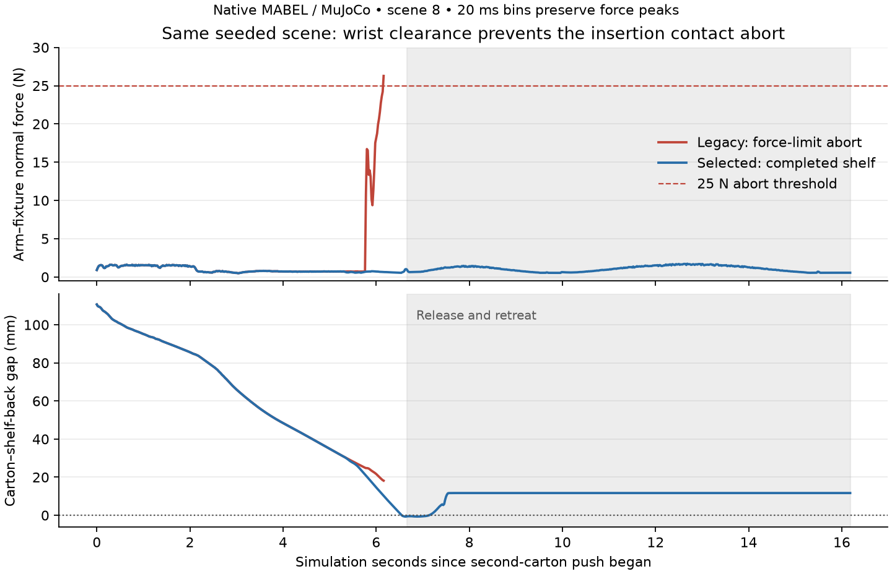
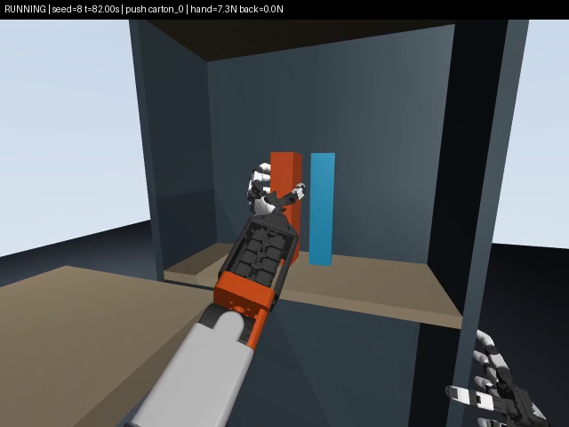

# Contact-control follow-up

The selected script completes **8/10 public regression scenes**, up from the
matched legacy program's **6/10**. After freezing the selected policy, a fresh
ten-scene suite gives **7/10 verified completions versus 4/10 for legacy**.
The legacy fresh suite includes one unknown native crash, retained in its
denominator. No verified baseline success regressed in either suite.

These are native MABEL MuJoCo rollouts with two rigid cartons per scene, a
stationary base command, left-arm manipulation and privileged world state.
Models, inertias, gains, collision masks, actuator limits and physical task
criteria are unchanged. All motion uses native actuator targets and stepping;
there are no object attachments, live pose writes or external object forces.

## Outcomes

| Metric | Regression legacy | Regression selected | Fresh legacy | Fresh selected |
|---|---:|---:|---:|---:|
| Complete scene, all gates, no observed tip/drop | 6/10 | **8/10** | 4/10 | **7/10** |
| Verified pick | 16/20 | 16/20 | 12/20 | 14/20 |
| Measured shelf support | 16/20 | 16/20 | 12/20 | 14/20 |
| Final positioning | 14/20 | **16/20** | 10/20 | **14/20** |
| Completed retreat without knocking any object over | 14/20 | **16/20** | 10/20 | **14/20** |
| Unknown process outcomes | 0 | 0 | 1 | 0 |

Every scheduled carton stays in each stage's denominator, including unreached
cartons and the unknown process. Stage gates record progress when achieved;
later disturbance can still fail a scene. All verified executions had zero
recorded interventions and no tip/drop incidents. This covers the observed
prefix of aborted runs, not unmeasured post-abort stability or recovery.

The public regression seeds are 0–9. Selected control resolves seed 6's rejected
release path and seed 8's insertion force abort, retaining the six earlier
complete scenes. Seeds 4 and 7 still abort during approach at the 25 N guard.

Fresh seeds 200–209 were generated only after policy freeze at
`c60d009f9f964ba6e5dcd6a7d16b90595b672d20`; no policy or numeric controller setting
changed in response to these outcomes. Selected control resolves verified
insertion failures on 203 and 208. Scene 204 changes from unknown to successful;
that is not evidence of recovery from a known physical failure. The three
selected-controller failures, 202, 206 and 207, are approach force-limit aborts.

For both suites, all ten declared scene/model input hashes **and** all ten
settled integration-state hashes match between baseline and selected runs.
Both variants use the same strengthened force coverage and final motion bounds.
The original historical report remains [separate](stocking_ten_scenes.md).

These samples are small. Wilson 95% intervals are 31.3–83.2% and 49.0–94.3% for
regression legacy/selected, and 16.8–68.7% and 39.7–89.2% for fresh legacy/selected.
The fresh legacy interval describes verified completion under this pipeline,
with its unknown outcome receiving no success credit; it is not a physical
failure classification. The results do not establish broad generalization.

## Changes responsible for the improvement

**Checked withdrawal alternatives.** When the original coupled finger-opening
and retreat path collides, the script checks bounded lateral alternatives,
preferring a direction away from the nearest object. It executes only a fully
accepted sampled arm/finger plan. In regression seed 6, a 2 cm lateral alternative
avoids the earlier carton without increasing the 2 mm collision allowance or
the 25 mm loaded-release displacement guard. Release-route search alone reaches
**7/10** on the public suite.

**Wrist clearance and measured unloading.** Native signed geometry distance
predicts `left_tower` clearance from the active shelf board before each insertion
step. The selected policy requests a 4 mm standoff, applies bounded position
corrections, and uses measured left-arm fixture normals for unloading. Feedback
uses the peak across each control interval's 2 ms samples. Final target bounds
are checked after every correction, before actuation. Clearance plus release
search reaches **8/10**. These finite sampled checks are not continuous collision
certificates or predictions of actual contact load.

**Broader force coverage.** The 25 N guard now includes combined active-carton
contact from both arm trees, including non-grasping links. Hand and non-grasp
normal forces remain separate trace channels. The same coverage applies to the
matched legacy and selected programs. Native geometry/gains are not edited.



Scene 8's legacy run aborts at 26.28 N arm/fixture normal force. The selected run
completes in 92.72 simulated seconds, with a whole-episode peak of 2.28 N in that
channel. The graph aligns both runs at the second carton's push; 20 ms bins
preserve the original 2 ms force peaks. The final back gap is shown rather than
presented as perfect flush packing. The carton reaches verified back contact,
then settles within the unchanged placement criteria after release.

Selected completed scenes have maximum observed per-axis XY target error of
9.8 mm in the regression suite and 9.7 mm in the fresh suite, against the fixed
35 mm tolerance. Success-conditional mean times are 87.83/88.39 simulated seconds
for regression legacy/selected and 88.27/89.45 seconds for fresh legacy/selected.
Those means cover different successful subsets and are not a speed comparison.

## Rejected experiments and remaining work

An earlier candidate enabled force-stopped approach and partial preshaping as
well as clearance feedback. It passed 8/10 development cases but regressed to
**4/10 public scenes**. Some short cartons lifted, then lost retention or support
later. It was not promoted. Guarded approach remains explicitly opt-in through
`--guarded-approach`; the current version additionally samples coupled proposed
arm/finger postures. A lift alone does not establish a good stocking grasp.

Higher and front-biased grasp probes were also rejected after carry or opposing
contact failures. The selected default keeps the original centered grasp-height
search. Development probes, including failures, remain under `outputs/contact-*`.
The next manipulation problem is predicting grasp quality through carry and
insertion, rather than accepting the first reachable endpoint. The selected
script still stops at early overloading; deliberate jam/tip recovery is not
demonstrated.

The fresh legacy scene-204 process ended with SIGSEGV and no terminal summary.
A separate serial diagnostic retry completed successfully. The cause has not
been isolated, so the original remains unknown and is not replaced or pooled
with the retry. Future campaigns enable Python fault traces and persist native
signal metadata. The local [backend investigation](../../home_robot_issues.md#sim-001--unreproduced-native-mujoco-signal-during-headless-mabel-control)
does not attribute the fault to Emet or claim an upstream reproducer.

## Reproduction and artifacts

Frozen policy revisions:

- `6475d70`: rejected guarded-approach candidate and its recorded development suite.
- `b18278e`: matched public legacy, release-only and clearance-controller studies.
- `c60d009f9f964ba6e5dcd6a7d16b90595b672d20`: selected default and both fresh suites.

At the selected revision, baseline and selected commands are:

```bash
abstract-stack batch --seeds 0 1 2 3 4 5 6 7 8 9 --objects 2 \
  --legacy-contact-control --output-dir outputs/baseline
abstract-stack batch --seeds 0 1 2 3 4 5 6 7 8 9 --objects 2 \
  --output-dir outputs/selected
# Use fresh output directories and seeds 200 ... 209 for the fresh suite.
# --no-fixture-avoidance isolates release search; --guarded-approach is experimental.
```

Physics uses MuJoCo 3.17.0, NumPy 1.26.4 and upstream MABEL revision
`d0181f04025c06e1790b7ab41fe44d602cc2ee5b`, with 2 ms physics, 20 ms control and a
180-second wall budget per physics-only episode. Two isolated serial workers
per cohort ran concurrently. The source revisions, effective settings, seeds,
full scene specifications, outcomes, force peaks, target errors and paired hashes
are in the [JSON evidence](contact_control_followup.json). Native traces, initial
and terminal integration states, applied controls and logs stay in ignored
`outputs/` directories referenced there. Future bundles/campaigns also record
per-file Python-source fingerprints, rather than relying on a model hash alone.

The [plot data](../../paper/evidence/contact_force_comparison.csv) and standalone
generator make the force figure reproducible without a simulator installation:

```bash
uv run scripts/plot_contact_comparison.py
```



Scene 8 has synchronized native `zed_left` and third-person H.264 MP4s, each
640×480, 10 fps and 928 frames including the labeled final pause. Its applied
controls and final product poses are bitwise identical to the headless selected
regression run, confirming that recording is passive. Local recordings:

```text
outputs/contact-selected-seed8-video/videos/third_person.mp4
outputs/contact-selected-seed8-video/videos/first_person.mp4
```

This remains a nearby two-carton bench task. Dense full-shelf packing, bottles,
bimanual coordination, navigation, perception, deliberate recovery and hardware
validation remain outside the demonstrated scope.
