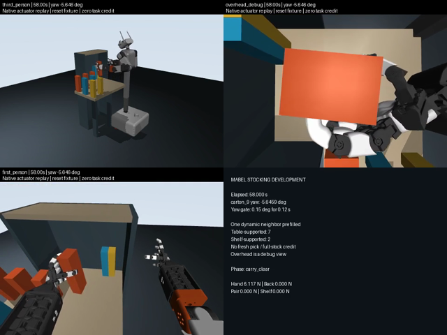

# Continuous next-carton stocking development

2026-11-17. The longer native-MABEL sequence now covers **153.386 seconds** of
continuous physics: square the existing carton, unload/retreat, clear the shelf,
change finger posture, pick another carton, carry, place, push and recover at the
backstop. Every selected segment boundary and terminal full integration state
replayed bit for bit. Model geometry, inertia, collision masks and actuator
parameters are unchanged. World state is privileged.

This starts from the declared squaring fixture, not a fresh stocking episode.
`carton_7` is a prefill; `carton_8` is already on the shelf at the start. Only
`carton_9` is newly scheduled for picking. The original failed episode and every
development branch remain retained; no fresh episode or full-shelf credit.

## Video and measured stages

Local ignored videos are in `outputs/continuous-stocking-video-v2/`:
`overview.mp4` (four views), `third_person.mp4`, `first_person.mp4`, and
`overhead_debug.mp4`. Playback is about 2 min 33 s. The overhead camera follows
the active carton for debugging; the two native robot/world cameras are fixed
to their original model definitions. The HUD counts actual native support
loads, rather than treating a planned placement as stocked.



| New carton 9 stage | Verified? | Evidence |
| --- | --- | --- |
| Pick | Yes | Opposing contacts, 62.13 mm rise, 6.23 N hand load, table support lost |
| Shelf support | Yes | Native support measured after transfer and seating |
| Final position | No | Recovery ends at 3.228 deg yaw and about 50 mm lateral target error |
| Retreat | No | Final squared-contact gate remains open; withdrawal not executed |

All products were monitored at each 2 ms physics step; no tip/drop incident was
recorded in the selected chain. First-carton squaring and retreat are verified
as described in the [earlier report](squaring_withdrawal_development.md).

The first rendered long video (`continuous-stocking-video-v1`) retains a stale
HUD phase label during the final recovery. It remains archived. **v2 corrects
the caption**, with the same recorded controls and fresh exact replay checks.

## What changed

`CheckpointContinuationEnv` uses the restored compiled model/data and normal
environment stepping/callbacks without resetting native time or poses. Unknown
historical task-stability intervals earn no credit. Recorded task memory is
restored only when shape, thresholds and current placement conditions agree.
Original outcomes, incident history and parent checkpoint hashes remain attached.

The local 40 mm withdrawal still leaves the fingertip inside the shelf. Before
changing finger posture, a checked actuator-only extension moved it another
142.5 mm out of the shelf with measured Cartesian feedback and no product
disturbance. Finger unfolding then used bounded native targets and coupled
arm/finger geometry checks. The original 0.35 m pregrasp lift and an intermediate
0.25 m setting hit the upper-board compensated-geometry guard; 0.18 m cleared it.
No collision acceptance or force thresholds were relaxed.

`MabelController(nominal_references=...)` can resume the explicitly known left
arm/wrist/lift references while holding unidentified right-arm targets exactly.
It does not relabel compensated controls as nominal or apply compensation twice.
Tool changes preserve the same known subset. Commands rejected before any native
time advances roll back tracker references and retain the unexecuted proposal.

The first measured loaded grasp could not reach the original rightmost slot.
Bounded transit yaw alternatives, including +/-40 degrees, and a separately
recorded wrist-headroom probe did not solve that route. The next planning action
explicitly permuted **carton 9 and carton 5's interchangeable target slots** before
placement. The destination was measured empty. All physical slot centers,
dimensions, whole-row 10 mm free-space budget and target tolerances persisted.
The model's decorative target markers are unchanged; the logical permutation is
recorded in scene metadata. Reassigning an already shelf-supported carton or
occupying a neighbor's measured envelope is rejected.

That route carried and seated the carton. A split-insertion branch stopped at
an empty-hand clearance rejection. A direct-insertion branch reached measured
backstop contact but timed out at 21.615 degrees yaw. A new declared contact
controller was reconstructed from the actual last pusher plan only after its
full native terminal state matched the recorded state. This adoption performs
no physics step and earns no manipulation credit.

The compliant continuation reduced yaw from 21.615 to 3.228 degrees over 16 s.
A further 16 s probe ended at 2.855 degrees. These are failures of the unchanged
0.15-degree gate. At the stall, nominal tool Z is near the lower contact corridor
and projected compensated proposals are rejected. The next controller work is
to resolve load/Cartesian tracking and lateral registration together; merely
extending the timeout or relabeling the final slot would hide the actual problem.

## Sources, attempts and reproduction

All eleven development attempts are retained under `outputs/continuous-next-stock-v*/`.
The first process failed on extra scene metadata during loading; it remains
unknown, with zero credit. Other failed pregrasp, transfer, partial-clearance
and final-squaring attempts remain in the ledger. Parameters were adjusted across
development snapshots; this is not a frozen-policy success-rate campaign.
See [the machine-readable ledger](continuous_stocking_development.json).

The selected control chain uses:

1. The three original `squaring-focus-v3/left-front-face-*` segments.
2. `squaring-longer-v4/force-unload-measured-retreat`.
3. `continuous-next-stock-v5` (next verified pickup; transfer planning stops).
4. `continuous-next-stock-v8-direct` (explicit slot permutation, carry/place/push).
5. `continuous-next-stock-v10-compliant-square` (unfinished backstop recovery).

```bash
flock /tmp/abstract-stack-render.lock .venv/bin/python scripts/continue_stocking.py \
  --checkpoint outputs/squaring-longer-v5/limit-diagnostics/terminal-checkpoint \
  --output outputs/my-next-pick --product carton_9 --pregrasp-height 0.18 \
  --wall-seconds 180

flock /tmp/abstract-stack-render.lock .venv/bin/python scripts/continue_stocking.py \
  --checkpoint outputs/continuous-next-stock-v5/terminal-checkpoint \
  --output outputs/my-slot-replan --product carton_9 --pregrasp-height 0.18 \
  --swap-slot-with carton_5 --no-split-insertion --wall-seconds 180
```

Use fresh outputs. A continuation retains the same scheduled manipulation;
inherited and newly observed stage evidence must be combined once by lineage,
not counted as separate episodes. The replay tool accepts the selected segment
directories in order and rejects any reset or model/state mismatch.

New runs use [Git-aware shared source bundles](../experiment_sources.md) and
hash-pinned checkpoint references. None of the eleven new run directories
contains Python files. The two final native contact probes reused the same
source bundle/runtime. Portable checkpoints contain compressed source archives;
historical source trees and failure evidence remain unchanged.
