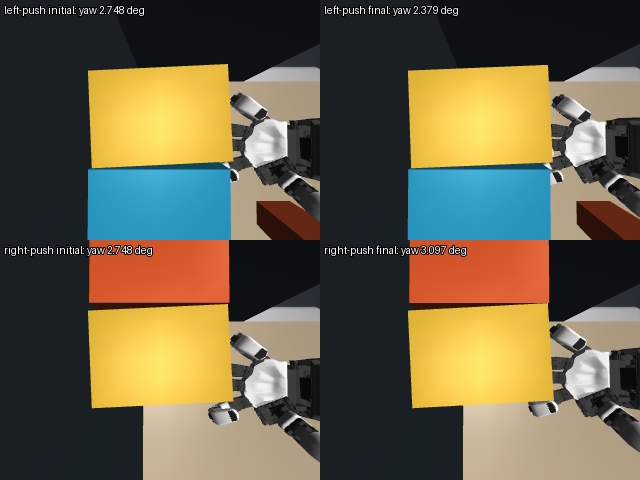

# Focused environmental squaring

Development evidence, 2026-11-17. These are declared reset fixtures and their
checkpoint continuations, with **zero pick or fresh task credit**. The ten-carton
task, release and retreat remain open. Effective settings and artifact hashes
are in [the companion JSON](environmental_squaring_development.json).

## Blockers

The retained `bound_limited_squaring` frame starts at 2.747583 degrees yaw. The
native left arm is at limits on Arm 2 and Arm 5, with a fixed wrist planning
posture. Several proposals fail bounded nominal geometry; others exceed the
captured applied-reference lateral corridor by only 14–27 micrometres. That is a
local planning restriction, not evidence of global unreachability.

All other nine cartons are still on the table in that frame. There is no shelf
neighbor to brace against. The active carton has drifted left: eight upright
cartons need 377.967 mm between it and the left wall, but its measured envelope
leaves 374.539 mm. A full-row prefill preserving that pose would overlap by at
least 3.428 mm, even before allowing gaps. We reject that fixture rather than
clip products or change the 10 mm whole-row budget.

## Fixtures and matched comparison

`neighbor_reset()` copies into new native data and moves one other carton only
during declared reset construction. The active carton, robot, clock, controls
and all other objects retain their captured state. The neighbor remains an
unchanged dynamic free body, initially 0.5 mm outside the active AABB. It is
neither anchored nor assumed wall-braced. Intersecting/nonfitting fixtures are
rejected. Eight cartons remain on the table; only the active carton is scheduled
for manipulation. The prefilled neighbor earns no pick credit.

The frozen four-case development suite compares held targets with a 1 N normal
setpoint and left/right lateral feedback. Push variants permit a bounded
15-degree wrist planning range. All four processes completed their two-second
physics budgets; none passed squared dwell or established neighbor force.

| Neighbor / controller | Final yaw (deg) | Peak carton-pair normal (N) |
| --- | --- | --- |
| Left / held | 2.483078 | 0 |
| Left / push | 2.379264 | 0 |
| Right / held | 2.483078 | 0 |
| Right / push | 3.096926 | 0 |

Most early yaw improvement is passive settling: the left push improves only
0.104 degrees over held targets. A nearby box in a render does not establish
bracing. Earlier fixed-wrist exploratory failures remain under
`outputs/squaring-focus-v1/`.



These overhead debug views are not student observations. Actuator replay reached
each recorded terminal integration state bit for bit before rendering its final
panel. Rendering left integration state unchanged. Renderer and evidence:
`outputs/squaring-focus-v3/{render_preview.py,render_evidence.json}`.

## Supported front-face recovery

The separate opt-in `--front-face-sweep` phase derives a lateral workspace from
the measured carton Y envelope with 6 mm edge margins, replacing the short
insertion corridor. That workspace is a search bound, not a collision
certificate. Nominal and compensated arm/finger proposals still need the original
endpoint, sampled-path, native-range and motion-rate checks. Native robot
geometry, actuator parameters and collision masks stay unchanged.

The left sweep with bounded wrist freedom passed the existing contact gate:

| Cumulative physics time (s) | Yaw (deg) | Squared dwell |
| --- | --- | --- |
| 0 | 2.747583 | No |
| 6 | 1.074397 | No |
| 12 | 0.197346 | No |
| 13.690 | 0.142659 | 0.120 s verified |

At verification, normal forces were 1.280 N hand, 1.718 N shelf support and
0.923 N backstop. Cumulative robot/product peak since fixture reset was 2.655 N;
non-grasping arm/product and robot/fixture loads were zero. No tip/drop incident
was recorded. Every product and force guard was sampled at each 2 ms step.
The 25 N guards, 0.15-degree yaw, 5-degree upright and 0.12-second dwell criteria
were unchanged. A separate 14-second held-target probe finished at 1.739978
degrees and did not pass dwell (`outputs/squaring-focus-v3/left-held-long-baseline`).
The three recovery workers took 125.74 seconds of wall time for 13.69 seconds of
physics; planning/forecast overhead still makes this a slow development policy.

**Carton-pair force remained zero.** This establishes backstop-assisted squaring
in one saved-state fixture, not successful side bracing. The final checkpoint's
held-control witness passed strict independent-process replay. Release/retreat
were not attempted. Sources/configuration were frozen per process; the chain
crosses bookkeeping source snapshots and is development evidence, not a single
frozen-policy validation campaign or fresh-episode success rate.

## Reproduction and next work

Use the existing focus-bank checkpoint; all output directories must be fresh:

```bash
flock /tmp/abstract-stack-render.lock .venv/bin/python \
  scripts/evaluate_squaring_focus.py \
  --checkpoint outputs/compliance-focus-v3/frames/bound_limited_squaring/checkpoint \
  --output outputs/my-squaring-comparison

flock /tmp/abstract-stack-render.lock .venv/bin/python \
  scripts/probe_compliant_lookahead.py \
  --checkpoint outputs/compliance-focus-v3/frames/bound_limited_squaring/checkpoint \
  --output outputs/my-front-face-recovery \
  --reset-neighbor left --sweep-side left --front-face-sweep \
  --normal-target 1 --wrist-freedom-deg 15 \
  --horizon 0.2 --candidates 10 --shortlist 4 \
  --execute-prefix 0.1 --replans 60 --require-dwell \
  --save-checkpoint --wall-seconds 120
```

Continue from `terminal-checkpoint` using the same sweep/dwell options and a new
output directory; omit `--reset-neighbor`. Monitor history, incidents,
nominal/applied references, effective admittance and wrist ranges survive the
continuation. Do not count a continuation as a new episode. Full actuator
controls and 2 ms force/yaw traces remain in ignored output bundles.

Next: establish measured neighbor force with a checked contact point/approach,
test both yaw signs and directions, then verify unloading and retreat. Return
to consecutive stocks and the zero-prefill ten-carton suite only after that.

Validation: 55 focused physics/checkpoint tests, all-file pre-commit and offline
source/wheel builds passed. The separate full-suite native process stability
gate remains open; no new PR or merge is part of this focused follow-up.
