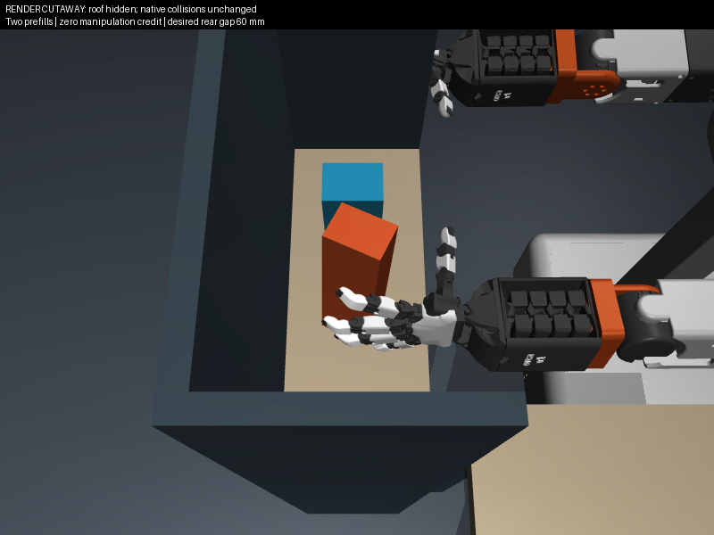

# Grasp skills, held-out checks and longer execution

2026-11-17. Perfect-state development on one fixed shelf. The opt-in grasp
teacher clears the earlier top-impact failure, and a later transfer change
completes **two consecutive stocks in 90.7 simulated seconds**, with zero prefills.
The three-carton continuation and rear-clearance task remain open. No student
has been trained and no dense ten-carton or general robustness claim is made.

## Videos

Local artifacts under `outputs/grasp-skill-v1/`:

- `two-carton-success-video-07/overview.mp4`: synchronized native third-/first-person
  views of the complete two-carton run. Original cameras are also in `videos/`.
  Every recorded actuator command was replayed, and the complete native terminal
  integration state matched exactly. Rendering changed no integration state.
- `original-failure-recovery-final-01/overview.mp4`: about 27 seconds, retrying the
  **saved pregrasp state** from the original top-impact failure, then lifting and
  holding the rotated carton. This is a checkpoint continuation, not a new stock.
- `composed-video-02/overview.mp4`: earlier two successful pickups followed by
  the retained transfer rejection. It remains archived.
- `three-carton-video-05/episode/videos/`: first pickup followed by a loaded
  transfer rejection. All three scheduled products remain in its denominator.

The first successful two-carton episode is `longer-transfer-03`;
`two-carton-current-08` and final closing-guard version `two-carton-final-09`
reproduce its entire actuator trajectory **bit for bit**. Video replays do not
count as extra successful trials.

## What fixed the grasp

The original force spike was the pinky striking the top of a carton that had
rotated about 63.3 degrees. IK permitted hand contact with the active object
throughout the descent and reported a small residual; that did not certify
clearance. The new `--grasp-skill` mode:

1. Specifies upright grasp yaw from the measured carton frame, mapped through
   carton symmetry into the bounded +/-90-degree range.
2. Checks native open-hand geometry at bounded centering offsets, retaining
   a 2 mm admission margin. A 4 mm / -4 mm grasp-frame offset supplies about
   5.3 mm endpoint clearance in the demonstrated states.
3. Establishes that orientation above the carton, then executes checked
   Cartesian-entry joint waypoints with explicit rate-based timing. Entry checks
   the active object normally, without blanket hand-contact permission. Closure,
   opposing contact, lift and retention still require native physics.

Neither the 25 N abort guard nor upstream geometry, inertias, actuator limits,
collision masks or task tolerances changed. Motion uses actuator targets and
MuJoCo stepping; no object pose writes, attachments or external object forces
establish manipulation success.

## Development, held-out and recovery results

The frozen standalone grasp source content ID is
`812295c2c9f151f013c041722d4b012856fa329d95703887495b1da45a6ecf60`.
Parent manifests retain the scoped Git/dirty provenance and full effective flags.
The following table records that initial snapshot; final hardening is below.

| Test | Scheduled / verified | Scope |
| --- | --- | --- |
| Fixed-geometry front pickup development | 8 / 8 | Existing +/-2 mm reset jitter, seeds 0–7; no geometry variation |
| Saved task-induced second pickup | 1 / 1 | Rotated entry after an earlier stock; development continuation |
| Isolated held-out front pickup | 3 / 3 | Fresh private entropy, frozen teacher, 0.5 s opposing-contact hold |
| Held-out two-pick sequences | 6 / 3 | All three first pickups pass; transfer blocks all three second pickups, which stay unreached failures |
| Original failed-run pregrasp recovery | 1 / 1 | Same frozen teacher, exact saved native state, no reset |

The sequence verifier independently replays native controls, requires exact
full terminal-state equality and checks opposing hand contact, hand load,
table clearance and the 25 N guard at every 2 ms step for the 0.5-second hold.
All products are monitored continuously for tip/drop events. Private held-out
seeds remain in ignored outputs only. The separate skill-only holdout uses new
seeds disjoint from the sequence holdout; no grasp controller changes were made
between those checks. These finite tests do not guarantee arbitrary-order or
arbitrary-pose 100% pickup.

The final teacher adds a coupled arm/finger collision check before **every**
closing command. Rejected commands do not advance physics and roll back the
unexecuted nominal reference. Its content ID is
`15184cddb3c8b54361dad63acae4071acba796cf79dac62f16d5ed41a5211ec0`.
After a passing development episode, three new independent private grasp-only
cases passed 3/3 under this frozen version, and the original saved-state recovery
passed again. The successful two-carton controls remain bit-identical. This is
additional scoped evidence, not a replacement for the earlier sequence failures.

The original checkpoint lacked intermediate nominal labels. Recovery explicitly
creates **new measured-pose nominal references**, keeps actual applied targets
separate, and holds unknown other-arm references. It does not relabel compensated
controls as historical nominal commands. Model and full integration state are
unchanged by that initialization. Historical failure/lineage remains attached;
new incident monitoring is scoped to the recovery prefix. The recovered pickup
peaks at 8.305 N robot/product load, loses table support and passes the hold,
with no new tip/drop incidents. The original failed episode remains failed.

## Longer execution and remaining route failure

Grasp orientation and shelf-placement orientation are different references.
After verified lift, the transfer now requests a world-aligned carton instead
of preserving its table yaw. This resolves the demonstrated second transfer.
The current mode also searches bounded shelf-front staging candidates from
the measured grasp, admitting only feasible endpoint/path and duration checks.

| Fixed two-carton episode | Result |
| --- | --- |
| Pick / shelf support / final position / retreat | 2 / 2 at every stage |
| Simulated episode time | 90.700 s, including initial settling |
| Interventions / prefills / tip-drop incidents | 0 / 0 / 0 |
| Peak robot–active-product normal | 8.239 N |
| Peak robot–fixture normal | 8.784 N |
| Original headless wall time / budget | 53.43 s / 120 s |
| Current bounded-staging repeat wall time / budget | 56.94 s / 120 s |

This is the spacious bench with 0.40 m nominal total unused row width, not the 5/10 mm
dense-row benchmark. The identical repeat is regression evidence, not a fresh
held-out whole-task success-rate study. The extended transfer controller is a
different frozen source from the standalone grasp teacher above.

The first three-carton request correctly rejected the 0.34 m supply table before
physics. A declared 0.42 m table accommodates the existing three-column supply
layout; shelf and carton geometry remain fixed. The resulting run picks carton 2
but rejects its loaded shelf approach at the native shoulder limit. Three
scheduled cartons remain counted: one verified pickup, zero shelf placements,
zero final placements and zero retreats. Four checked front-clearance candidates
also fail; this bounded local search does not prove global unreachability.
Next, plan a different loaded route or checked base action from that measured
grasp. Do not accept the 0.119 m endpoint miss or relax collision/IK gates.
The terminal loaded state is captured at
`three-failed-transfer-checkpoint/checkpoint/` for focused continuation work;
its import retains the original outcome and the exported-XML identity limitation.

## Skill distributions and rear clearance

The [skill curriculum](../skills.md) defines grasp/lift/hold, transfer, shelf
placement, contact finishing and release/retreat. `composed-01` captures
2, 2, 1, 1 and 1 entry states respectively. Every entry includes all object
poses/velocities and native support forces, controller references and a native
checkpoint. They describe the actual preceding skill's outputs, including
disturbed inventory, rather than independent nominal poses. The sample is small
and comes from an earlier transfer version; refresh it when collecting training
data. These snapshots are **not causal demonstrations** and remain ineligible
for training.

The separate [rear-clearance layout](../../configs/scenes/pick_place_rear_clearance.json)
requests a 60 mm gap behind stocked objects. The preview has two explicit
prefills, zero scheduled manipulations and approximately 50/60 mm actual gaps
after native settling. The roof is hidden only in the render; physics and
collision masks remain unchanged. A pose-based finishing controller and final
gap evaluation are still needed. The successful two-carton video above uses
the original backstop task and does not solve this harder variant.

## Validation and retained failures

The broader focused suite passed 193 tests, including native physics, old two-carton
regression, grasp geometry/timing, storage/checkpoint corruption contracts,
recording, held-out recovery eligibility and LfD. A subsequent 62-test targeted
suite passes with the final closing guard and related native contracts. Native
video replay, the final complete two-carton run and fresh held-out/recovery runs
are additional evidence. Pre-commit and offline package builds pass. Full-suite
native process stability remains a separate historical open issue.

All earlier attempts remain retained: blocked rear-first grasps; two initially
misgraded isolated probes whose full-stocking failure label conflicted with the
separate successful grasp gate; the corrected scope runs; rejected loaded routes;
invalid three-carton layout; and an unknown composed run interrupted by disk
exhaustion. The corrected harness does not rewrite earlier reports. Only the
regenerable uv cache was removed. Byte-identical complete MJBs share storage
while all original paths/hashes and failed partial artifacts remain.

Reproduction commands and every source/process/artifact reference are in the
[compact evidence ledger](grasp_skill_development.json). All outputs are local;
no training, upload, upstream write, merge or default-policy promotion occurred.
