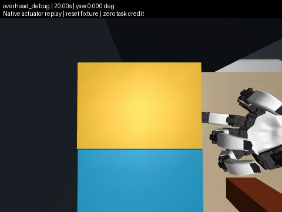

# Squaring video and longer supported withdrawal

Development follow-up, 2026-11-17. One active carton, one declared dynamic
neighbor prefill, eight cartons still on the table. No fresh pick or full-stock
credit. The original ten-carton task and measured neighbor bracing remain open.
This extends [focused squaring](environmental_squaring_development.md).

## Video

The initial video replays 13.690 seconds of squaring. The longer video replays
20.166 seconds continuously: square, tighten the controller target, unload,
retreat and settle. Every boundary and terminal **full integration state** was
checked bit for bit. There are no pose resets between segments. Rendering does
not change integration state. The source starts from the declared fixture;
the videos do not show a pickup or a fresh stocking episode.

Ignored local artifacts:

- `outputs/squaring-video-v1/overview.mp4`: initial four-view squaring video.
- `outputs/squaring-longer-video-v1/overview.mp4`: longer four-view video.
- Both directories also contain `third_person.mp4`, `first_person.mp4`,
  `overhead_debug.mp4`, exact replay evidence, copied inputs and source hashes.

Robot and third-person cameras are unchanged native cameras. Overhead is a
debug render, not a student observation. Forces shown are the recorded native
2 ms trace aligned to replay timestamps. Full recordings remain ignored.



## Longer primitive and failures

The first unload/retreat cleared the hand but yaw rebounded from 0.143 to
0.194 degrees, failing the unchanged 0.15-degree final criterion. We retain
that failure in `outputs/squaring-longer-v1/withdrawal`.

`--squaring-reserve-deg 0.05` keeps controlling after the 0.15-degree gate until
a tighter controller target is reached. It does not change the task criterion,
contact dwell or force abort limits. This gave enough alignment reserve for
unloading. A nominal-FK retreat prototype passed in development v2, but its
physical tool moved 35.13 mm back and 33.18 mm up for a nominal 40/20 mm command.
That discrepancy matters when chaining the next pickup.

The current withdrawal uses actual Cartesian tool feedback. Its first version
spent its bounded unload budget chasing the waypoint after pressure had already
gone; v3 is retained as a timeout. The selected version ends unloading on
measured unloaded, squared support, then tracks the actual clearance target.
It completed both stages:

| Quantity | Selected v4 native evidence |
| --- | --- |
| Added simulation duration | 6.476 s (including 0.656 s extra squaring) |
| Actual hand translation during withdrawal | +39.924 mm X, +20.011 mm Z |
| Final carton yaw | 0.0000594 deg |
| Final robot/product normal | 0 N |
| Final shelf support / backstop normal | 1.683 N / 0.601 N |
| Released squared support at end | 4.500 s continuous |
| Peak robot/product normal since fixture reset | 2.655 N |
| Tip/drop incidents | None |

The 59 focused tests and native experiment evidence are separate from the open
full-suite native process stability gate. These tuned development branches are
not a frozen-policy success-rate evaluation. All attempted processes, partial
controls, timeouts and rejected gates remain in `outputs/squaring-longer-v*/`.

## Guard and controller contract

`ContactMonitor.begin_withdrawal()` requires a fresh verified supported square
dwell at the current native timestamp. Only then can intentional hand contact
loss stop being a push failure. All force, support, external-input, robot-link
and every-product tip/drop checks remain active. Phase, entry time, incidents,
force peaks and timers survive checkpoints; old checkpoints default to push.

The controller keeps native fingers held, uses actuator targets and stepping,
and replans every 20 ms. Each proposed nominal and compensated arm/finger pose
passes collision/path, final range and rate checks. Every 2 ms physics step is
guarded. Applied-minus-nominal offsets remain explicit; measured tool feedback
corrects their inaccurate unloaded response. Source v4's peak measured tool vs
nominal-FK discrepancy was 11.893 mm, **separate** from the final translation
target error (about 0.077 mm). This is not a claim of uniformly submillimetre
native tracking. v5 adds explicit limit/IK/projection diagnostics.
Its complete actuator array and terminal integration state were bit-identical
to v4. Withdrawal hit no joint/rate limits or native target projections; peak
nominal IK error was 0.000000189 m and 0.0000438 degrees, separate from measured
execution tracking. The final withdrawal checkpoint also passed independent
strict replay verification.

Final withdrawal admission requires zero-load robot/product contact (<=0.2 N),
shelf support >0.2 N, yaw <=0.15 degrees, tilt <=5 degrees, linear/angular speed
below 0.04 m/s and 0.2 rad/s, sustained for >=0.12 seconds. Measured retreat
clearance must be at least 35 mm X / 15 mm Z for the 40/20 mm target, and carton
movement during withdrawal <=5 mm. No 25 N force limit or task tolerance was
relaxed. Final checkpoints explicitly identify `retained_finger_withdrawal`;
the push runner rejects them rather than misreading historical dwell as fresh.

## Reproduce and continue

```bash
flock /tmp/abstract-stack-render.lock .venv/bin/python \
  scripts/probe_compliant_lookahead.py \
  --checkpoint outputs/squaring-focus-v3/left-front-face-last-mm/terminal-checkpoint \
  --output outputs/my-reserve-and-withdraw \
  --sweep-side left --front-face-sweep --squaring-reserve-deg 0.05 --withdraw \
  --normal-target 1 --horizon 0.2 --candidates 10 --shortlist 4 \
  --execute-prefix 0.1 --replans 60 --require-dwell \
  --save-checkpoint --wall-seconds 120

MUJOCO_GL=egl flock /tmp/abstract-stack-render.lock .venv/bin/python \
  scripts/render_checkpoint_chain.py \
  --segments outputs/squaring-focus-v3/left-front-face-recovery \
    outputs/squaring-focus-v3/left-front-face-continuation \
    outputs/squaring-focus-v3/left-front-face-last-mm \
    outputs/squaring-longer-v4/force-unload-measured-retreat \
  --output outputs/my-longer-video --wall-seconds 180
```

Outputs must be fresh. Render failures/mismatches preserve logs and partial
videos but never produce a verified replay result. See
[machine-readable evidence](squaring_withdrawal_development.json).

Next, hand off the cleared state to the general grasp controller, check the
finger-preshape transition and next table approach, then execute a second
pickup/stock without resetting. The regular episode integration must preserve
the stage observer and demonstration recorder at every physics step. Extend
to several consecutive cartons before returning to the zero-prefill ten-carton
suite. The saved active pose still does not admit the full intended fixed-slot
row; measured placement/rearrangement planning is also required.
