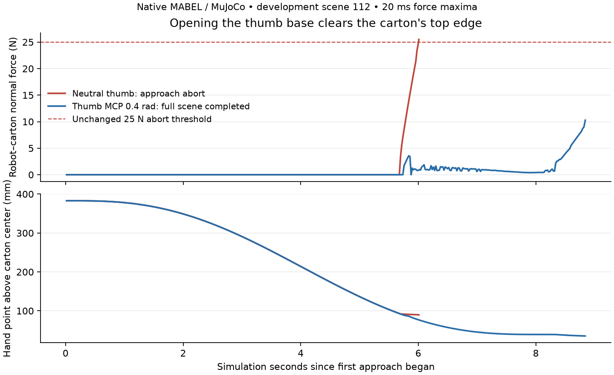
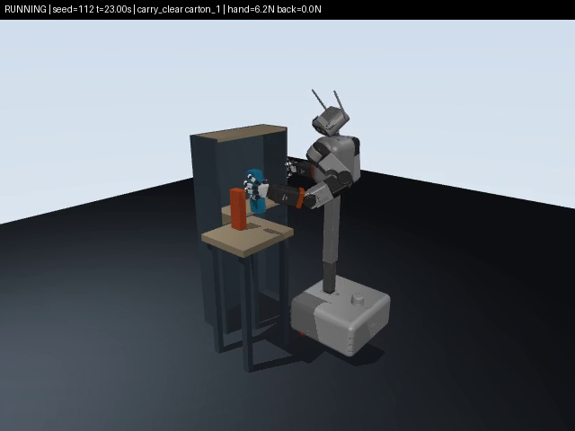
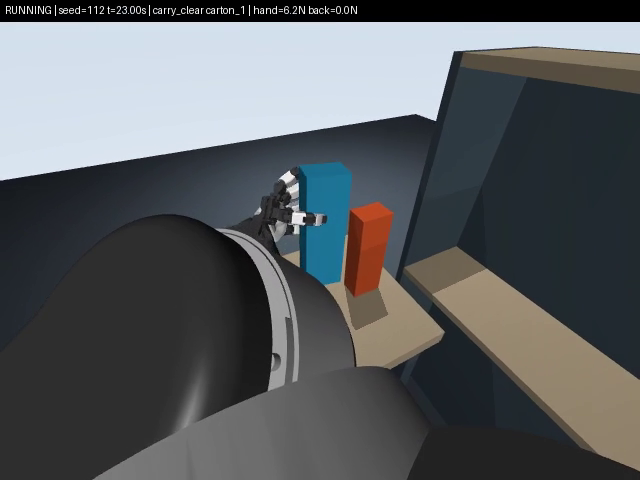

# Thumb-preshape follow-up

This report pins the intermediate **6 N grip / 2 N push** policy. The subsequent
[compliance study](compliance_followup.md) evaluates and selects the lower-force
defaults; its additional dense-task limitations remain explicit.

Opening MABEL's left thumb base before descent completes **10/10 scenes in
each of three two-carton suites**, including a fresh suite generated after the
policy was frozen. All **60 scheduled cartons** pass measured pick, shelf
support, final positioning and retreat gates. There are no unknown outcomes,
interventions or observed tip/drop incidents in these selected-policy runs.

## Complete-task results

| Suite | Neutral thumb | Thumb MCP 0.4 rad | Selected pick / place / final / retreat |
|---|---:|---:|---|
| Public regression, 0–9 | 8/10 | **10/10** | **20 / 20 / 20 / 20**, each out of 20 |
| Earlier fresh suite, now regression, 200–209 | 7/10 | **10/10** | **20 / 20 / 20 / 20**, each out of 20 |
| New frozen-policy suite, 300–309 | 7/10 | **10/10** | **20 / 20 / 20 / 20**, each out of 20 |

Neutral-thumb stage counts are 16/20 for every stage in the public suite and
14/20 for every stage in each other suite. Every scheduled carton remains in
the denominator, including unreached cartons. The fresh neutral-thumb failures
are approach force aborts on 302, 308 and 309; they remain in the evidence.
All three comparisons match every declared scene/model input hash and every
actual settled integration-state hash. The two earlier neutral cohorts are
retained historical measurements, not newly rerun baselines.

These are separate small pilots, not a pooled generalization estimate. The
fresh suite's 10/10 Wilson 95% interval is approximately **72.2–100%**. The policy
is a handwritten feedback program with privileged world state, stationary base
commands and left-arm manipulation of two tall, rigid cartons. Crowded shelves,
bottles, navigation, coordinated bimanual actions and deliberate jam/tip recovery
have not been validated by these results.

## Contact diagnosis and change

The native `left_thumb_mp` geometry caught the carton's top edge during open-hand
descent. The robot could reach the requested pose kinematically, but executing
it pressed the supported object into the table until the 25 N guard aborted.
Raising the grasp target alone did not clear this obstruction in the two short-
carton development cases.

The controller now commands `Left Thumb MCP = 0.4 rad` before descent and retains
that reference during closure, carry and withdrawal. This stays inside the
native ±0.87266 rad limits. The target is represented in empty/loaded IK and
coupled hand opening/closing checks. All upstream geometry, inertia, actuator
gains, transmissions, limits and collision masks remain unchanged. Live motion
uses actuator targets and MuJoCo stepping, without attachments, pose writes or
external object forces.



This is development scene 112 with the same production policy and only the
thumb flag changed. Twenty-millisecond bins preserve original 2 ms combined
robot/carton force peaks. The plot ends at the first lift command; complete-task
success is verified separately from the full episode. The earlier controller
stops about 9 cm above the carton center; preshaping reaches the centered grasp
height and establishes opposing contact.

Ordinary joint-path IK samples the proposed future finger posture rather than
the initial thumb opening sweep. These finite geometry checks do not certify
continuous collision freedom or predict contact load. Per-physics-step force,
slip, support and all-product incident guards remain active during execution.

Selected maximum final per-axis XY target errors are **5.61 mm**, **5.33 mm** and
**6.49 mm** for the three suites, against the unchanged 35 mm task tolerance.
Their maximum whole-episode hand-normal forces are **11.06 N**, **10.98 N** and
**11.23 N**. Mean successful-scene completion times are 86.93, 86.91 and 86.75
simulated seconds. Baseline means cover different successful subsets and should
not be read as a paired speed comparison.

## Development and compliance search

Four height-only probes on 112/119, at 0.4 and 0.45 times carton half-height
above the center, all aborted during approach. Ten thumb-posture probes tested
native MCP and abduction references. Negative MCP and the tested abduction
changes did not clear approach; MCP 0.85 on 112 and 0.6 on 119 lifted but failed
carry alignment. MCP 0.4 completed both short-carton cases. All 14 outcomes,
including failures, are retained in the JSON and ignored raw directories.

These exploratory probes used temporary reference overrides based on `bd2bbae`;
they did not check future thumb geometry in all IK queries. They are development
evidence only. The production implementation adds that geometry and separately
passes 100/112/119, then the frozen suites above. Probe scripts are retained in
`outputs/thumb-preshape-development-scripts/`; reproducing their original
behavior requires the historical source, not the current default preshape.

The bounded compliant-control search uses separate development scenes 100/101,
one round, seven configurations and fourteen scheduled episodes. Success gates,
collision acceptance and the 25 N abort limit are fixed. Candidate acceptance
first preserves clean-scene success, unknown/incident counts and stage progress,
then compares the sum of per-case peak force and total simulation time.
The best complete development candidate uses **4.5 N balanced-grip target** and
**1.875 N push target**. On the two development cases, the sum of per-case
maximum measured force decreases from **20.2175 to 15.7277 N (22.2%)**; total
simulation time changes from 173.10 to 173.60 seconds. This force statistic is
not an episode-average force or impulse.

| Trial | Grip target / push target / upright speed | Development outcome | Accepted |
|---|---|---|---|
| 0 | 6 N / 2 N / 0.3 rad/s | 2/2 complete | Initial incumbent |
| 1 | 4.5 N / 2 N / 0.3 rad/s | 2/2 complete | Yes |
| 2 | 5.625 N / 2 N / 0.3 rad/s | 2/2 complete | No |
| 3 | 4.5 N / 1.5 N / 0.3 rad/s | 2/2 complete | Yes |
| 4 | 4.5 N / 1.875 N / 0.3 rad/s | 2/2 complete | Yes |
| 5 | 4.5 N / 1.875 N / 0.225 rad/s | 2/2 complete | No |
| 6 | 4.5 N / 1.875 N / 0.375 rad/s | 1 complete, 1 unknown | No |

The final search orchestration ended with status 143 while scene 101 had no
terminal summary. Its child exit status and termination cause are unknown.
That episode receives zero stage credit: **13 verified completions and one
unknown across fourteen scheduled search episodes**. Original `search.json`
and `trial-06/campaign.json` remain unchanged. The explicitly reconstructed
`search-finalized.json` and `trial-06/campaign-finalized.json` retain the missing
scheduled outcome and leave the winning complete candidate unchanged. The
unknown scene's 240-second search-score time cost is an imputation, not measured
elapsed time. No retry replaces this outcome, and it is not classified as a
known physical failure or an upstream simulator defect.

## Reproduction and artifacts

The frozen production source is
`95107d78c725d5f254a51a2ee7a91ef541b4e61c`. Earlier neutral-thumb measurements
use `b18278e` for the public suite and `c60d009` for 200–209. Fresh neutral and
preshape suites both use `95107d7`, differing only in `thumb_preshape`.
All effective settings and Python-source hashes are in the
[machine-readable evidence](thumb_preshape_followup.json).

At the frozen checkout, use fresh output directories:

```bash
abstract-stack batch --seeds 300 301 302 303 304 305 306 307 308 309 \
  --no-thumb-preshape --episode-timeout 300 --output-dir outputs/neutral
abstract-stack batch --seeds 300 301 302 303 304 305 306 307 308 309 \
  --episode-timeout 300 --output-dir outputs/preshape
abstract-stack tune --seeds 100 101 --rounds 1 --output-dir outputs/search
abstract-stack solve --random-scene --seed 112 --video --fps 10 --render \
  --output-dir outputs/preshape-video
```

Each ten-scene cohort ran as two isolated five-scene serial workers. Historical
neutral cohorts declared 180 seconds per physics-only episode; all new cohorts
declare 300 seconds. No historical timeout occurs in these paired comparisons.
This changes the compute budget, not the 240-second simulated task limit or any
physical gate. The separate search declares 180 seconds per child episode;
its final orchestration termination is retained separately as unknown.
MuJoCo is 3.17.0, NumPy is 1.26.4 and native MABEL is pinned at
`d0181f04025c06e1790b7ab41fe44d602cc2ee5b`. Physics/control periods are 2/20 ms.
The full recordings, states and controls remain in ignored `outputs/`.

Generate the compact JSON from the original manifests:

```bash
.venv/bin/python scripts/summarize_stocking_campaigns.py \
  --campaign previous_public=outputs/contact-clearance-only/campaign.json \
  --campaign preshape_public=outputs/thumb-regression-v1/campaign.json \
  --campaign previous_known=outputs/contact-fresh-selected/campaign.json \
  --campaign preshape_known=outputs/thumb-known-v1/campaign.json \
  --campaign neutral_fresh=outputs/thumb-fresh-ablation-v1/campaign.json \
  --campaign preshape_fresh=outputs/thumb-fresh-v1/campaign.json \
  --pair previous_public=preshape_public \
  --pair previous_known=preshape_known --pair neutral_fresh=preshape_fresh \
  --development-probes outputs/thumb-preshape-development-probes.json \
  --search outputs/thumb-compliance-search-v1/search-finalized.json \
  --output docs/reports/thumb_preshape_followup.json
```

The collector verifies matching reset and settled-state hashes for every named
pair. It retains terminal outcomes, stage evidence, all-object retreat motion,
actual final poses and target errors. The plotting command and peak-preserving
CSV are documented in [paper evidence](../../paper/evidence/README.md).

## Dual-view recording

The completed scene-112 episode is saved locally as
`outputs/thumb-preshape-112-video/videos/third_person.mp4` and
`outputs/thumb-preshape-112-video/videos/first_person.mp4`. Both are native
640×480 H.264 streams at 10 fps, each with **864 frames**: 854 synchronized
physics frames and ten labeled final-pause frames. The robot-mounted view uses
`zed_left`; head gaze uses native neck actuator references.




The episode completes at 86.34 simulated seconds. Every recorded physics sample
and all 59 actuator-control channels are bitwise identical to the corresponding
headless development run. Rendering did not change that rollout. The images
above are unedited frames from the MP4s at the same simulation timestamp.
