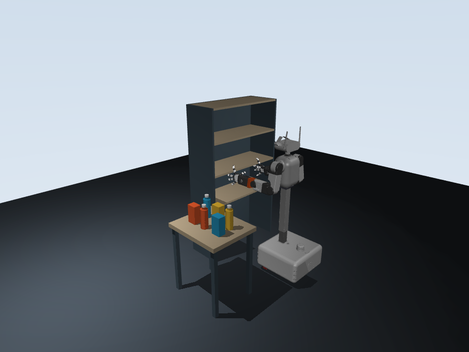

# Shelf scene setup

The initial scene is a fixed shelf, a supply table, rigid cartons and bottles,
and an optional full MABEL robot. Scene geometry lives here; robot geometry and
actuators come from the pinned upstream model. No upstream source edits are
required.



## Build and inspect a scene

```bash
./install.sh
source .venv/bin/activate

# Fetch MABEL if needed, build the starter scene, and render three views.
abstract-stack build-scene --scene stocking --fetch-mabel --render \
  --output-dir outputs/stocking

# Open the same scene and seed in the MuJoCo viewer.
abstract-stack sim --scene stocking --seed 0
```

`build-scene` creates:

| File | Contents |
| --- | --- |
| `scene.xml` | Episode-start MJCF, including the imported robot when enabled. |
| `manifest.json` | Resolved configuration, seed, initial poses and controls, product targets, robot source revision, package versions, and settled scene metrics. |
| `overview.png` | Full layout after settling, when `--render` is supplied. |
| `shelf_front.png` | Oblique front view of shelf levels and target locations, clear of the robot's torso. |
| `supply_overhead.png` | View of products on the supply table. |

The build command resets the episode and runs up to one simulated second of
normal dynamics to check the layout and produce previews. `scene.xml` and the
manifest's initial state describe the start before settling; `settled_metrics`
describes the later preview state. Reusing an output directory replaces the
generated files with the current build. Keep different configurations/seeds in
different output directories when comparing them.

Without a working graphics backend, omit `--render`; XML, metadata, and the
physics settling check still work. Rendered builds default to EGL; an existing
`MUJOCO_GL` selection is respected.

## Starting layouts

| `--scene` | Shelf and products | Purpose |
| --- | --- | --- |
| `empty` | Starter shelf/table, no products. MABEL is included by default. | Check robot pose, camera views and cabinet geometry. |
| `stocking` | 0.90 m shelf; six products on the supply table; initially empty shelf. | Begin continuous stocking. |
| `tight` | 0.62 m shelf; 18 products total, 12 already on the shelf and six on the table; 12 mm target gaps. | Inspect contact-rich insertion amongst existing products. |
| `house` | Furnished small house, MABEL, starter shelf and six movable products. | House-scale scene and stocking setup. |
| `house_tight` | Same house with 18 products and 12 prefilled shelf placements. | Tighter stocking inside the house. |
| `pick_place` | Two tall narrow cartons on a small table beside MABEL and one shelf. | First-pass physical interaction tuning; see the [script status](scripted_interactions.md). |

See [MABEL in a small house](house_scene.md) for its floor plan, room views,
physical walls, and cutaway rendering.

```bash
abstract-stack sim --scene empty
abstract-stack sim --scene tight
abstract-stack build-scene --scene tight --robot none --render \
  --output-dir outputs/tight-no-robot
```

Prefilled products are free bodies resting on the shelf, so they can be pushed,
tipped and rearranged. They become stocked only after passing the same support
and stability checks as newly placed products. The initial count is recorded
separately. Empty scenes have no stocking goals and do not terminate immediately
with success. These presets establish layouts; they do not execute a grasp or
stocking policy.

## Dimensions and coordinate frames

All distances are metres, masses kilograms, and angles radians. MuJoCo world
axes use +Z up. At its default pose MABEL faces -X; the shelf opens toward +X.

- The shelf's internal width runs along Y and its depth along X. Its front edge
  is at `front_x`; its rear interior is at `front_x - depth`.
- `center_y` moves the shelf sideways. The static `shelf` body origin is
  `(front_x, center_y, 0)`.
- `levels` contains the **top surfaces** of the usable boards, not their centres.
  Board solids extend downward from these heights by `board_thickness`.
- A roof board is added at `levels[-1] + top_clearance`. Side panels and a back
  close the unit. The defaults give 0.31 m of clear space between boards.
- The supply table top is at `table_top`. Its `supply` body is centred in XY on
  the table. With `table_center_y: null`, the table automatically stays 6 cm
  beyond the shelf's side panel when the shelf width changes.
- Product target positions describe body origins, at half the product height
  above the assigned board. Supply products start 3 mm above their support
  surfaces and settle under gravity.

Cartons are 9 × 7 × 17 cm boxes of mass 0.18 kg. Bottles are rigid assemblies
of cylindrical body, neck and cap, bounded by 6.8 × 6.8 × 22 cm, of mass 0.25 kg.
The marked target footprints are non-colliding sites. Products are distributed
round-robin over shelf levels, with horizontal spacing derived from product
width plus `target_gap`.

## Edit the layout

Copy the fully expanded starter geometry configuration:

```bash
mkdir -p configs
cp src/abstract_stack/configs/stocking.json configs/my_shelf.json
# Edit configs/my_shelf.json, then:
abstract-stack build-scene --config configs/my_shelf.json --render \
  --output-dir outputs/my-shelf
abstract-stack sim --config configs/my_shelf.json
```

Custom JSON files start from `ShelfConfig` defaults, not from another preset.
Unknown fields and layouts that cannot fit the configured product set are
rejected. `--config` and `--scene` are mutually exclusive. The same selections
work with `sim`, `inspect`, `export`, `serve`, and `build-scene`.

| Field | Default | Controls |
| --- | --- | --- |
| `width`, `depth` | `0.90`, `0.36` | Shelf interior footprint. |
| `front_x`, `center_y` | `-0.62`, `0.0` | Shelf placement in the world. |
| `levels` | `[0.65, 0.98, 1.31]` | Top surfaces of the usable boards. |
| `board_thickness`, `top_clearance` | `0.02`, `0.33` | Board solids and height to the roof's top. |
| `table_top`, `table_size` | `0.70`, `[0.60, 0.50]` | Table height and full XY size. |
| `table_center_x`, `table_center_y` | `-0.30`, `null` | Table placement; null Y follows shelf width. |
| `product_count`, `initially_stocked` | `6`, `0` | Total products and prefilled shelf products. |
| `target_gap` | `0.045` | Edge-to-edge target spacing along Y. |
| `spawn_jitter` | `0.008` | Maximum seeded supply-position jitter per horizontal axis. |
| `robot_xy`, `robot_yaw` | `[0.0, 0.0]`, `0.0` | MABEL's initial base position and heading. |
| `spawn_lift_offset` | `0.0` | Lower the lift by this many metres at reset (max 0.15). The stocking, tight, empty and house presets use `0.05` so the upstream home pose does not start with fingers inside shelf board 1. |
| `environment` | `"studio"` | Bare scene, or `"small_house"` to include the furnished house. |
| `product_kind`, `carton_size` | `"mixed"`, `[0.09, 0.07, 0.17]` | Mixed bottles/cartons or `"carton"` only; carton full XYZ dimensions. |
| `target_back_gap` | `null` | Gap from the box back face to the shelf back; null keeps centred targets. |

Timing/evaluation fields are also accepted: `timestep`, `frame_skip`,
`time_limit`, `stable_seconds`, `target_tolerance`, and `enable_sensors`.
Supply products use up to three columns with at least 15 cm X and 14 cm Y spacing; enlarge
the table or prefill more objects if the remaining products do not fit. Clearance
validation covers product sizing; visually check custom robot/table placements
for reachability and collisions before collecting demonstrations.

## Import MABEL

```bash
abstract-stack fetch-mabel
abstract-stack inspect
```

The fetcher obtains `robotmabel/open_mabel` revision
`d0181f04025c06e1790b7ab41fe44d602cc2ee5b`, including model/mesh directories and
upstream license files. Its source-checkout destination is
`third_party/open_mabel/`. This directory is ignored by Git. A wheel installation
uses `$XDG_CACHE_HOME/abstract-stack/open_mabel`, or
`~/.cache/abstract-stack/open_mabel` if that variable is unset.

The canonical entry point is
`simulation/mabel_mujoco/models/mabel_full.xml`. Import resolves its mesh paths
to absolute paths, retains both arms, both existing hands and the cameras,
and applies the configured base XY/yaw while preserving the model's base height.
The combined starter scene has `nq=109`, `nv=102`, and `nu=59`. The empty scene
with MABEL has `67`, `66`, and `59` respectively.

Use an existing checkout explicitly:

```bash
export MABEL_ROOT=/path/to/open_mabel
abstract-stack sim --scene stocking
# Or use a per-command path:
abstract-stack sim --mabel-root /path/to/open_mabel
```

`--fetch-mabel` downloads only when the model is missing. Existing directories
are never reset or overwritten. To intentionally use a different upstream
revision, provide your own checkout; the manifest records its actual Git SHA.
The imported geometry and meshes keep their upstream licenses. MABEL controller,
VR and mjlab packages are separate integrations.

MABEL has three velocity-driven wheel channels, position-driven steering and
limb channels, and a tendon-driven lift spanning two stages. Reset holds total
lift extension at 0.3175 m instead of commanding the lift to zero. If loading
the exported MJCF yourself, apply keyframe zero and appropriate actuator holds
before stepping; a bare `MjData` starts all control values at zero. No base weld
or fixed-base substitution is applied in the local simulation.

```python
from abstract_stack.config import load_scene_config
from abstract_stack.env import ShelfStockingEnv

env = ShelfStockingEnv(load_scene_config(scene="tight"), seed=7)
try:
    observation, info = env.reset(seed=7)
    observation, reward, terminated, truncated, info = env.step()
finally:
    env.close()
```

For transport/control integration, run `abstract-stack serve --scene stocking
--headless`. The Emet adapter and its current navigation limitations are
described in the [README](../README.md#emet-connection).

## Export and verification

The exported XML references MABEL meshes by absolute path. Keep the checkout
available when reopening it; moving an XML file alone to another machine does
not copy robot assets. The manifest records the seed, resolved settings and
actual model revision so the scene can be rebuilt on another machine.

```bash
abstract-stack sim --scene stocking --headless --steps 100
abstract-stack sim --scene tight --robot none --headless --steps 100
uv run pytest
```

Tests check geometry/target alignment, reproducible reset/export state, empty
scenes, prefilled-product stability, MABEL pose import, actuator holds and task
success criteria. Idle stability and rendered previews do not establish robot
reachability, successful grasping, VR comfort or autonomous recovery.
