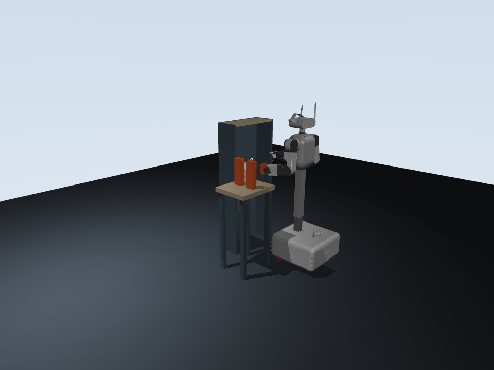

# Scripted stocking: first physical prototype

The first-pass controller starts two boxes on a small table beside MABEL and
attempts approach, grasp closure, lift, transfer, release and push-to-contact.
It uses native robot actuators and MuJoCo contacts. There are no live pose
writes, object attachment constraints, external object forces or disabled
contacts in the rollout.

**Acceptance is still open:** the current controller rejects the initial grasp
in preflight, takes a bounded staging step, and stops for replanning before
closing the hand. It has not demonstrated a verified pickup, placement
or shelf-back push. The tests validate physics instrumentation, safeguards and
artifact integrity; they do not assert full task success. Keep the control PR
in draft until the task has measured end-to-end evidence.


The historical seed-0 baseline, before IK prefiltering, stopped after 15 simulated seconds with 17.4 cm of hand
tracking error (3.5 cm limit). Measured peaks were 10.65 N for hand/box, 23.61 N
for support/box and 23.27 N for arm/fixture contact; shelf-back contact was zero.
No products completed the task. Its mixed position/orientation IK objective was
also large; it was not a position error in metres. These historical numbers and
images are failure evidence, not a stocking result or the current controller's
behavior.


With the prefilter, the seed-0 initial grasp search finds a best endpoint
candidate within collision tolerance with a 4.0 cm positional miss and 18.3 degrees of orientation
error, exceeding the 1.5 cm/12 degree limits. Accurate geometric solutions can
instead intersect the neighboring box with the wrist. The direct joint path
also encounters the shelf side. The controller therefore stages less than
10 cm along a checked prefix, predicts 28.5 cm remaining distance to the box,
and measures 28.7 cm afterward. Its hand position differs from the predicted
staging position by 1.2 cm. Both boxes remain upright, with zero hand/box contact
and no stocking success. Arm/fixture forces still reach 18.5 N: finite collision
sampling and geometric clearance tolerances do not guarantee contact-free
dynamics.

The 1.2 cm staging execution gap is mainly downward: ordered forward-kinematics
substitution attributes 8.1 mm vertically to measured arm/wrist offsets and
3.55 mm to lift sag, with less than 0.1 mm from base/uncontrolled coordinates.
Holding the same actuator targets for another two seconds leaves about 1.2 cm
of error, so extra settling does not fix it. The native lift position servo has
stiffness 80,000 N/m; its measured load of about 284 N requires a 3.55 mm position
offset to generate that force. This controller has no load feedforward. The
arm uses finite position gains too; its offsets can reflect gravity and contact
loads. The native wrist's position gain is just 1. These facts motivate load
compensation and measured Cartesian feedback in subsequent controller work,
independently of rejecting an invalid IK request. Native gains remain unchanged.
`execution_diagnostics` records the ordered FK displacement components; this
decomposition alone does not isolate which forces caused each joint offset.



## Run it

```bash
source .venv/bin/activate
abstract-stack fetch-mabel
abstract-stack sim --scene pick_place
abstract-stack script --render --output-dir outputs/scripted-stocking
```

The script is headless and runs at simulation speed. `--render` adds phase
images and a final view; it needs a working EGL or other MuJoCo GL backend.
Without rendering, force and state recording still work. Exit code **0** means
the script completed its physical checks and the task's final stability test;
exit code **2** means a measured stage failed. Inspect `summary.json` before
interpreting a run as successful.

```bash
abstract-stack script --max-force 20 --grip 0.7 \
  --output-dir outputs/grip-07
```

`--max-force` is the maximum permitted summed normal force in newtons for hand,
back-wall or arm/fixture contact categories. Exceeding it aborts the rollout at
a physics step. Changing that threshold does not change success criteria.
`--grip` is a bounded closure fraction, not a measured grasp force. The native
actuator torque limits remain in effect.

```bash
# Reject unacceptable requests without a best-effort staging motion:
abstract-stack script --no-best-effort --output-dir outputs/ik-hold
# Change the bounded orientation candidate search (degrees):
abstract-stack script --ik-orientation-span 30 --output-dir outputs/ik-span30
```

## IK preflight and predicted error

The old controller requested the same palm orientation at every waypoint. The
new preflight first tries that preferred orientation, then rotations of
±20/±40 degrees about each local axis by default, using several bounded seeds
per orientation. It verifies the final forward kinematics after solving. A pose
must meet separate position (1.5 cm) and orientation (12 degree) tolerances.
The report includes both residuals, the selected rotation, its deviation from
the preferred orientation, and active joint/lift limits. A failed search means
`no_acceptable_solution_found`; it is not proof of global unreachability.

The initial grasp endpoint is screened before approach. Every free-space move
then checks the endpoint and a sampled joint-interpolation path for robot/world
and self collisions with the planned finger posture. Wheel/floor contacts are
expected; target-object/hand contact is allowed only for explicit manipulation
phases. Penetrations exceeding 2 mm, or an existing penetration by more than
1 mm, are rejected. These checks use scratch data and preserve live physics.
Accepted joint paths execute with a smooth quintic timing profile and native
rate/actuator bounds. Online Cartesian IK also rejects excessive residuals
before producing commands.

If no acceptable pose/path is found, an empty hand may take a checked prefix
with at least 5 mm of predicted progress and at most 10 cm of predicted Cartesian
excursion. This staging motion allows no target-hand contact exemption, retains
the remaining miss, and **always stops for replanning before grasp closure**.
If no such prefix exists, or `--no-best-effort` is set, the controller holds.
Carrying phases hold on rejection. This is a conservative local fallback;
automatic base repositioning, obstacle-routing and grasp regeneration remain
future work.

Predictions hold the base and other uncommanded coordinates at their measured
poses. They are kinematic estimates, not dynamic forecasts. Reports separate
the predicted remaining target miss, actual target miss, and
`prediction_execution_gap_m` (measured hand versus predicted hand position).
The sampled straight joint paths are not continuous collision certificates;
they do not model a carried object's swept volume. Force/tilt guards and actual
tracking/physical grasp checks remain required during execution.

## Bench and controller

The `pick_place` preset is a stationary studio bench, separate from the house
navigation task. It uses two 0.18 kg cartons of full size 7 × 5 × 24 cm, a table
at 0.80 m, one shelf at the same height, and a target near the shelf back. This
small reproducible scene is intended for control tuning before returning to
mixed products and house-scale motion. The physical floating base is retained.
The script currently uses the left arm and the shared lift; it is not yet a
bimanual or navigation policy.

The controller performs bounded damped pose IK using scratch `MjData`. It
commands the seven arm joints, the hand wrist and the tendon-driven lift,
respecting both joint and actuator limits. It limits arm/wrist targets to
1 rad/s and lift targets to 0.08 m/s. Finger MCP/PIP targets close gradually.
The final push is a slow displacement command that stops on measured sustained
box/back and hand/box contact, with a hard contact-force abort.

| Stage | Required evidence before proceeding |
| --- | --- |
| Grasp precheck | Acceptable endpoint IK position/orientation and collision prediction before any approach. |
| Retract, raise, pregrasp, approach | Accepted IK and sampled path; measured hand tracking within 3.5 cm at the waypoint; finite physics and bounded contact forces. |
| Close | Loaded opposing contact normals on the box from the hand. |
| Lift | Box rises with the hand, retains hand contact, and loses table support. |
| Transfer/place/release | Actual object motion and shelf-board support; hand force falls after opening. |
| Push | Box/back normal force at least 0.4 N plus hand contact for at least 0.12 s. |
| Finish | Both boxes meet the environment's assigned placement and stability conditions. |

The approach/grasp geometry and pose tracking need further tuning. A waypoint
plan being present in code does not show those stages succeeded in physics.
The native hand has 17 joints; a single closure fraction is a starting grasp
profile and will not reliably handle every box shape or pose.

## Recorded evidence

| Artifact | Contents |
| --- | --- |
| `initial-scene/scene.xml` and `manifest.json` | Seed, scene settings, object dimensions/poses, MuJoCo version, model source revision and initial controls. |
| `rollout_start.npz` | Complete MuJoCo integration state after the initial settling interval, plus its state-spec enum. |
| `trace.npz` | Samples and native actuator controls recorded at every 2 ms physics step. |
| `summary.json` | Controller parameters, phase times, IK predictions/rejection reasons, predicted versus measured errors, failed condition, completed products, actual actuator lengths and peak forces. |
| Phase PNGs and `final.png` | Optional visual context; these do not replace numeric acceptance. |

Trace columns are listed in `summary.json`: simulation time, box XYZ, hand XYZ,
summed hand/support/back/arm-fixture normal forces in N, and Cartesian tracking
error in m. The support category includes the table and shelf boards; release
verification specifically requires shelf-board support. Force vectors come from
`mujoco.mj_contactForce`, not actuator commands or guessed spring forces.
The trace's control rows align with the physics-step samples; use the event
timestamps to identify each phase/product. The file contains commanded inputs,
not an independently validated replay or demonstration dataset.

During a checked joint-path move, the trace's tracking reference is forward
kinematics of the applied joint targets at the preflight base pose. The event's
`requested_position_error_m` is distance to the original waypoint, which may be
large after intentional staging. `last_ik_residual` is retained only as a legacy
mixed objective for online IK; use the structured `ik_prediction` fields for
position and orientation errors. A staging event's prediction remains rejected
for the original target even when its sampled prefix is acceptable.

```python
import json
import numpy as np

root = "outputs/scripted-stocking/"
summary = json.load(open(root + "summary.json"))
trace = np.load(root + "trace.npz")
print(summary["physical_success"], summary["failure"])
print(summary["peak_forces_N"])
print(trace["samples"].shape, trace["controls"].shape)
```

Do not increase tolerances, disable contacts, fix the base or add a grasp latch
to convert a failed trial into unassisted physical success. Separate successful
hand tracking, opposing contact, lifting, stable release and sustained pushing
into independently measured acceptance gates.
