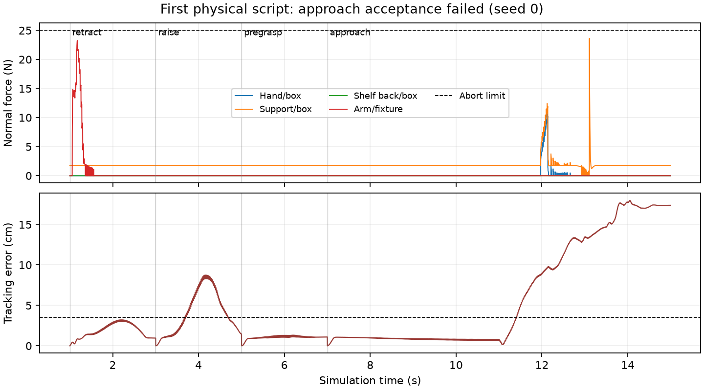
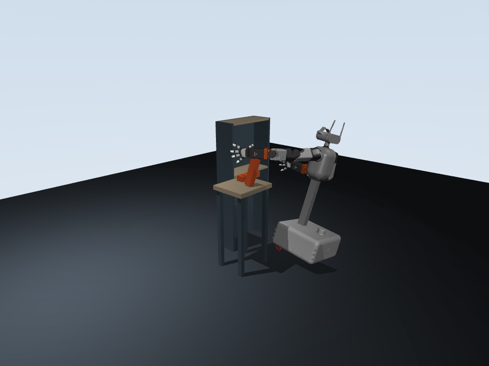

# Scripted stocking: first physical prototype

The first-pass controller starts two boxes on a small table beside MABEL and
attempts approach, grasp closure, lift, transfer, release and push-to-contact.
It uses native robot actuators and MuJoCo contacts. There are no live pose
writes, object attachment constraints, external object forces or disabled
contacts in the rollout.

**Acceptance is still open:** the current controller stops during approach on
measured tracking error. It has not demonstrated a verified pickup, placement
or shelf-back push. The tests validate physics instrumentation, safeguards and
artifact integrity; they do not assert full task success. Keep the control PR
in draft until the task has measured end-to-end evidence.



The seed-0 baseline stopped after 15 simulated seconds with 17.4 cm of hand
tracking error (3.5 cm limit). Measured peaks were 10.65 N for hand/box, 23.61 N
for support/box and 23.27 N for arm/fixture contact; shelf-back contact was zero.
No products completed the task. The final IK residual was also large, so the
next investigation is pose feasibility/branch selection and floating-base
stability, followed by grasp-profile tuning. These numbers are failure evidence,
not a stocking result.



## Run it

```bash
source .venv/bin/activate
abstract-stack fetch-mabel
abstract-stack sim --scene pick_place
abstract-stack script --render --output-dir outputs/scripted-stocking
```

The script is headless and runs at simulation speed. `--render` adds phase
images and a final view; it needs a working EGL or other MuJoCo GL backend.
Without rendering, force and state recording still work. Exit code **0** means
the script completed its physical checks and the task's final stability test;
exit code **2** means a measured stage failed. Inspect `summary.json` before
interpreting a run as successful.

```bash
abstract-stack script --max-force 20 --grip 0.7 \
  --output-dir outputs/grip-07
```

`--max-force` is the maximum permitted summed normal force in newtons for hand,
back-wall or arm/fixture contact categories. Exceeding it aborts the rollout at
a physics step. Changing that threshold does not change success criteria.
`--grip` is a bounded closure fraction, not a measured grasp force. The native
actuator torque limits remain in effect.

## Bench and controller

The `pick_place` preset is a stationary studio bench, separate from the house
navigation task. It uses two 0.18 kg cartons of full size 7 × 5 × 24 cm, a table
at 0.80 m, one shelf at the same height, and a target near the shelf back. This
small reproducible scene is intended for control tuning before returning to
mixed products and house-scale motion. The physical floating base is retained.
The script currently uses the left arm and the shared lift; it is not yet a
bimanual or navigation policy.

The controller performs bounded damped pose IK using scratch `MjData`. It
commands the seven arm joints, the hand wrist and the tendon-driven lift,
respecting both joint and actuator limits. It limits arm/wrist targets to
1 rad/s and lift targets to 0.08 m/s. Finger MCP/PIP targets close gradually.
The final push is a slow displacement command that stops on measured sustained
box/back and hand/box contact, with a hard contact-force abort.

| Stage | Required evidence before proceeding |
| --- | --- |
| Retract, raise, pregrasp, approach | Measured hand tracking within 3.5 cm at the waypoint; finite physics and bounded contact forces. |
| Close | Loaded opposing contact normals on the box from the hand. |
| Lift | Box rises with the hand, retains hand contact, and loses table support. |
| Transfer/place/release | Actual object motion and shelf-board support; hand force falls after opening. |
| Push | Box/back normal force at least 0.4 N plus hand contact for at least 0.12 s. |
| Finish | Both boxes meet the environment's assigned placement and stability conditions. |

The approach/grasp geometry and pose tracking need further tuning. A waypoint
plan being present in code does not show those stages succeeded in physics.
The native hand has 17 joints; a single closure fraction is a starting grasp
profile and will not reliably handle every box shape or pose.

## Recorded evidence

| Artifact | Contents |
| --- | --- |
| `initial-scene/scene.xml` and `manifest.json` | Seed, scene settings, object dimensions/poses, MuJoCo version, model source revision and initial controls. |
| `rollout_start.npz` | Complete MuJoCo integration state after the initial settling interval, plus its state-spec enum. |
| `trace.npz` | Samples and native actuator controls recorded at every 2 ms physics step. |
| `summary.json` | Controller parameters, phase times, failed condition, completed products, final metrics, IK residual, actual actuator lengths and peak forces. |
| Phase PNGs and `final.png` | Optional visual context; these do not replace numeric acceptance. |

Trace columns are listed in `summary.json`: simulation time, box XYZ, hand XYZ,
summed hand/support/back/arm-fixture normal forces in N, and Cartesian tracking
error in m. The support category includes the table and shelf boards; release
verification specifically requires shelf-board support. Force vectors come from
`mujoco.mj_contactForce`, not actuator commands or guessed spring forces.
The trace's control rows align with the physics-step samples; use the event
timestamps to identify each phase/product. The file contains commanded inputs,
not an independently validated replay or demonstration dataset.

```python
import json
import numpy as np

root = "outputs/scripted-stocking/"
summary = json.load(open(root + "summary.json"))
trace = np.load(root + "trace.npz")
print(summary["physical_success"], summary["failure"])
print(summary["peak_forces_N"])
print(trace["samples"].shape, trace["controls"].shape)
```

Do not increase tolerances, disable contacts, fix the base or add a grasp latch
to convert a failed trial into unassisted physical success. Separate successful
hand tracking, opposing contact, lifting, stable release and sustained pushing
into independently measured acceptance gates.
