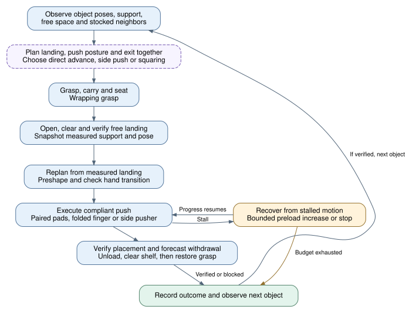

# Skill curriculum and initial distributions

Start with perfect state, a fixed single-level shelf, rigid 70 x 50 x 240 mm
cartons and the existing supply layout. No policy learning or scene/dynamics
randomization is required to establish the scripted teacher skills. Reset
jitter is the existing +/-2 mm with a recorded seed.

The objective is reliable pickup on this **declared, task-conditioned** initial
distribution. A 100% observed score on a small development set is not a
guarantee over all poses or a statistical robustness result. Keep unsafe,
unreached, failed and unknown cases in their scheduled denominators.

## Decomposition

| Skill | Initial-state distribution to collect | Measured exit gate |
| --- | --- | --- |
| Grasp/lift/hold | Fresh front carton, plus remaining cartons after preceding stocks: object pose/velocity, neighboring inventory, empty-hand posture and table support | Opposing contact, actual rise, retained hand contact, no table support, then 0.5 s loaded hold |
| Transfer | Outputs of verified grasps: actual object-to-hand transform, payload yaw/tilt, arm/lift posture, inventory and shelf clearance | Retain the load through the checked shelf-approach route |
| Shelf placement | Outputs of transfer: measured rotated extents, carried pose/velocity, shelf height and grasp offset | Native shelf support within the original bounded seating range |
| Contact finishing | Supported placements with measured depth/lateral/yaw error, contact partners and wrench | Task-specific final position/alignment/contact dwell; unchanged force guards |
| Release/retreat | Verified supported finishing states, including residual hand load | Unload, withdraw, and preserve every required product's support/pose/stability |

`StockingScript._grasp_and_lift()` is shared by the complete stocking sequence
and `GraspSkillProbe`; transfer/placement is separately callable. Placement,
contact finishing and release already have separate control entry points. These
are five skill boundaries, not five trained policies. Transfer is still a
single composed route and does not yet have an independent learned controller.

## Why reset poses are insufficient

In the original fixed two-carton failure, carton 1 was picked first. Before the
second pickup, carton 0 had moved and reached about 63.3 degrees yaw. The pinky
hit its top during descent. IK had permitted all hand/active-carton contact and
reported a tiny endpoint residual; that did not certify a safe grasp entry.

The corrected teacher specifies grasp yaw from the measured object frame, checks
bounded centering offsets (at most 8 mm in each horizontal grasp-frame axis),
requires 2 mm open-hand clearance, sets the orientation above the object, and
executes retained Cartesian entry waypoints. During entry the active object has
no blanket hand-contact permission. Joint-rate cost times the retained path;
the code does not interpolate straight to the final joint configuration.
Actual closure, opposing contact and lift still require native physics.
Each closing command checks the proposed coupled arm/finger posture before
actuation. Failure rolls back the unexecuted nominal command and stops the skill.

In the initial composed seed-0 follow-up, the grasp entries have about 0 and 63.58
degrees yaw. Both cartons lift about 56 mm with zero measured table support
and approximately 4.7 N hand load. The first stock completes; the second
transfer is rejected by IK. The transfer entries themselves have roughly
-31.7 and +31.5 degrees payload yaw. Thus that skill must start from actual
grasp outcomes, not a nominal rigid attachment assumption.

A later opt-in transfer change uses world-aligned carton orientation after
verified lift, rather than preserving the table yaw as a placement goal. It
completes two stocks in 90.7 simulated seconds on the fixed bench. A bounded
shelf-front staging search preserves that native trajectory exactly. Three
cartons still reject loaded staging at native shoulder limits. These transfer
versions are distinct from the frozen standalone grasp teacher.

Trying the rear carton while the front carton is still present is a different
entry condition: native wrist/tower geometry intersects the front carton.
Those scheduled probes remain rejected failures in the broader test report.
The task planner currently admits front-first order; the rear carton is tested
again from the state after that first stock. Do not silently discard the blocked
cases or claim arbitrary-order 100% pickup.

## Record and inspect skill starts

```bash
MABEL_ROOT=third_party/open_mabel flock /tmp/abstract-stack-render.lock \
  .venv/bin/abstract-stack script --scene pick_place --seed 0 \
  --grasp-skill --record-skill-starts --output-dir outputs/my-skill-sequence

MABEL_ROOT=third_party/open_mabel flock /tmp/abstract-stack-render.lock \
  .venv/bin/python scripts/evaluate_grasp_skill.py \
  --output outputs/my-grasp-development --seeds 0 1 --products carton_1
```

`skill-entries/index.json` lists every reached entry, zero-sample skills, and
empirical position ranges/yaw samples. These ranges describe observed states;
they are not independently sampled uniform priors. Each `entry.json` contains
**every** object's pose, velocity, dimensions and support/hand forces, plus tool
and base position. A full native checkpoint includes distinct hand/tracker
nominal references, applied controls, observer incident/retreat history and task
memory. Capturing an entry does not step the live world. Identical native MJBs
within an episode share storage only after full checkpoint verification; each
checkpoint still has its complete model file and original hash.

The isolated runner also accepts `--checkpoint PATH --seeds 0 --products carton_0`
for a saved `grasp_lift` entry. It validates the entry identity, restores known
nominal/applied references and task/observer history, and performs no reset.
Retained entries earn no new full-episode or stocking credit.

These files are privileged distribution/checkpoint evidence. They are marked
training-ineligible and do not replace causally aligned pre-action observations
and nominal actions. Next, wire the existing LfD recorder into these skill
boundaries and collect verified demonstrations before training students.

## Rear clearance task

[pick_place_rear_clearance.json](../configs/scenes/pick_place_rear_clearance.json)
is a separate fixed layout with a **60 mm desired rear gap** behind stocked
cartons and zero prefills. Shelf and robot geometry are unchanged; target poses
move forward. This interprets “behind” as the space between stocked cartons and
the shelf back wall. Supply-table clearance is unchanged.

The existing backstop controller is unsupported for this task: it deliberately
seeks wall contact. A rear-gap teacher needs pose-based depth registration and
supported unloading/retreat, and must report actual rear clearance after release.
Do not relabel back-wall contact as success or apply the old contact evaluator
to claim the new task complete. Keep the old backstop test as a separate skill
fixture. The new layout itself establishes no manipulation success.

Current evidence and videos: [grasp development](reports/grasp_skill_development.md).

## Base relocation and 2D navigation

When a loaded shelf route is out of the left arm's reach (its `Left Arm 2`
adduction range bottoms out at `-0.175 rad`), the opt-in `--base-reposition`
mode relocates the base through native swerve wheels. The route is planned on a
scene occupancy grid with `emet` A* ([`navigation.py`](../src/abstract_stack/navigation.py)),
which re-marks every measured product footprint as an obstacle, so randomized
object positions are reflected in the map. The idle right hand is swung outward
first, and the pregrasp move uses a checked Cartesian entry. See the
[three-carton report](reports/navigation_three_carton.md).

## Contact skill cases for later training

With `--record-skill-starts`, the episode's `skill-entries/index.json` catalogs
restorable cases. Each entry stores measured poses, velocities, mass, support
and hand loads, completed neighbors, tool and controller state, and the seed.
Checkpoints share one native model binary per episode through hard links. The
native state and validation witness remain specific to each entry.

| Case | Entry variation to retain | What to measure during execution |
|---|---|---|
| Acquire and lift | Mass, footprint, grasp skew, support material | Opposing contacts, lift, slip |
| Transfer and seat | Grasp offset, obstacle and fixture clearance | Load retention, shelf support |
| Side registration | Exposed side, wall or neighbor, lateral error | Signed advance, yaw, unload |
| Front squaring | Skew, projected clearance beside stocked items | Yaw, support, displacement |
| Forward insertion | Depth error, mass, friction, free space | Signed advance, wrench, support |
| Loaded push recovery | Force without motion, depth remaining | Renewed advance, load, recovery choice |
| Recovery exhausted | Remaining gap, force and elapsed stall time | Failure evidence for alternative skills |
| Contact refinement and retreat | Pose error, preload, neighbors and support | Final pose, stable release, safe clearance |

Preload changes are one recovery. Unload and re-contact at a different height
or offset, a side push, and a pivot are separate candidate skills. Record
their outcomes under the same evaluation criteria when implemented. The entry
catalog describes reached states and should retain failures and unreached
cases. Split later evaluation by scene seed and object properties to avoid
putting correlated checkpoints from one episode into both training and
testing. Entry snapshots by themselves carry zero fresh-task credit and are
ineligible as causal training demonstrations.

### Plan the landing and contact moves together



The dashed box shows the proposed joint search. Solid boxes show the skill
sequence and its measured outcomes. The current full withdrawal forecast
runs after contact execution. The earlier tight insertion supplies the paired,
folded and side-push postures. A planner candidate must check its own hand
transition, approach, push and exit.

Regenerate both formats from `docs/media/contact_skill_flow.dot` with Graphviz
using `dot -Tsvg` for the docs and `dot -Tpdf` for the paper.

The current controller now verifies and records the free landing after the
grasp hand clears. The landed carton must be upright, supported, and unloaded
before side registration or forward insertion can start. The landing and final
task targets appear separately in the event log.

The remaining planner gap is landing selection. For each candidate landing
pose, check the carried approach, opening and grasp-hand exit, then check
access for a separate pusher and its exit at the proposed final pose. Compare
direct forward advance, forward-then-side registration, and a pre-squaring
step only when measured geometry calls for it. Use remaining free space as
working room. Choose a target depth that leaves room behind the object unless
the task calls for backstop contact. Reobserve at every handoff and replan the
next step from the actual pose. A candidate without an exit should be rejected
before choosing the landing. Keep each phase independently measurable and
retain failed candidates for the skill catalog.
