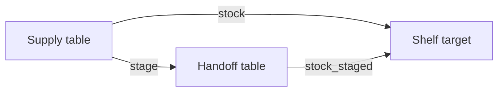

# Multi-station stocking room

Build a MuJoCo room with two shelves, eight rigid products, and one canonical
MABEL at the first station. The generator reuses the single-shelf fixture and
product geometry.

```bash
MUJOCO_GL=egl uv run --no-sync python scripts/build_stocking_room.py \
  --stations 2 --products-per-station 4 --seed 17 --mabel --render \
  --output-dir outputs/room-layout-mabel-17
```

Omit `--mabel` to build without robot assets. Omit `--render` to export without a
graphics context. The generator accepts one to four stations and one to nine
products per station. `--product-kind carton` selects all cartons. The seed
controls supply positions independently at each station. Each output directory
contains `room.xml`, `manifest.json`, a shared source reference and, when
requested, `room_overview.png`. The MABEL MJCF uses absolute upstream mesh paths.

## Scene interface

Call `build_stocking_room(RoomConfig(...), mabel=True)` to get the MJCF and typed
station and product records. Read the manifest for the world-frame IDs and
geometry. Bind by names at load time because MuJoCo integer IDs are model-local.

| Field | Interpretation |
| --- | --- |
| `bounds_xy` | World-frame rectangle in `xmin, xmax, ymin, ymax` order, in metres. Station rectangles mark exclusive work areas. |
| `approach_xy_yaw` | Suggested MABEL base reference in metres and radians. Zero yaw uses the canonical MABEL heading toward −X. A robot adapter must still validate navigation and reach. |
| `supply_geom`, `handoff_geom`, `target_support_geom` | Physical contact geometry for source, relay and shelf board. |
| `spawn_xyz`, `target_xyz` | World-frame product body centers. Shelf targets preserve 0.08 m of space behind each product. |
| `handoff_xy`, `handoff_half_size_xy`, `handoff_top_z` | World-frame surface center, half extents and support height for one staged product. |
| `body`, `half_size_m`, `mass_kg` | Free-joint body name, half dimensions of the collision envelope and modeled mass. Bottles use a rigid cylindrical body, neck and cap. |

Shelf fronts open toward +X. The shared travel aisle lies east of station zones
at `x > 1.05 m`. The room is open on the aisle side. The preview hides wall
geometry group 5 while native physics retains those wall contacts.

## Robot and coordinator handoff

`RoomDispatcher` is a single-process coordinator intended to run in the same
serialized loop as a shared scene observer. Register each robot's supported
station IDs, product kinds and skills with a `RobotProfile`. Three skills are
available:

- `stock` moves one product directly from supply to its assigned shelf target.
- `stage` moves a product from supply to the station handoff table.
- `stock_staged` takes that product from the handoff table to its shelf target.



1. From the latest world observation, call
   `claim(profile, station_id, state_revision=...)`. A claim reserves the
   station and the robot, and names the product and source and destination
   geoms. Stations can be assigned independently. The world observer owns
   monotonically increasing state revisions.
2. The robot adapter resolves names to current observations, checks approach,
   and runs the physical skill. The destination board can be shared by multiple
   targets, so verify the named product's specific target pose as well as
   support, upright stability, release and safe retreat. Apply the established
   robot-native force guards throughout execution.
3. Submit a `PlacementReceipt` with the observation revision and verified
   product, support and retreat to `complete`. A new claim can use a staged
   product after the producer's verified retreat. A staging receipt does not
   count toward stocked inventory.
4. On failure, call `report_failure` with the latest observation revision. The
   coordinator holds the station and robot unavailable until a supervisor
   verifies restoration at the original physical support and submits a newer
   receipt to `confirm_source_restored`. Log the failed skill and checkpoint
   separately before any retry.

The coordinator consumes verification supplied by adapters. Its receipts are
task bookkeeping, and benchmark outcomes require native physics evidence. The
current room instantiates at most one MABEL, and the existing single-shelf
executor still needs a room adapter to bind the namespaced station targets.
Before running two physical robot instances in one model, add per-robot MJCF
namespaces and namespaces for controller observations and actions, shared aisle
reservation, collision-aware travel, and a shared monitor for every product.
The relay is a supported set-down and regrasp, with no simultaneous hand-to-hand
transfer. The fixture preview establishes no pick, insertion or retreat result.
