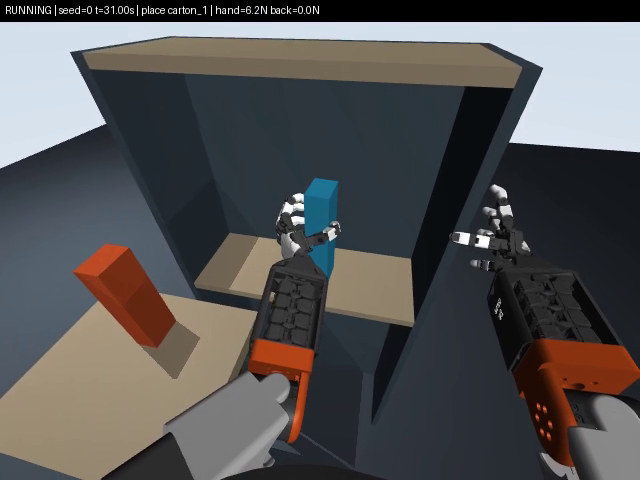

# Random scenes, world-state solving and dual-view MP4s

The current solver uses privileged MuJoCo object/robot state. Camera videos are
observations of real simulated execution, not perception inputs to the policy.
The initial scene family contains rigid cartons on one nearby table and one
shelf. MABEL's base and objects remain dynamic; motion uses native actuators.
There are no object attachments, live pose writes or external object forces.

## Generate a scene

```bash
abstract-stack random-scene --seed 7 --objects 2 --output outputs/scene7.json
abstract-stack sim --config outputs/scene7.json --seed 7
```

The seed controls carton dimensions, shelf width/depth/position, table height
and position, target spacing and spawn jitter. Generation is deterministic and
checks product fit. Width scales with object count when needed; the right shelf
edge stays clear of the robot's idle hand. The generator accepts 1–6 cartons;
valid geometry does not guarantee a reachable or successfully solved task.
The sidecar `scene7.manifest.json` records the seed and full configuration.

## Solve and record

Install the optional system encoder (`ffmpeg`, including `ffprobe`) and an EGL
runtime for headless rendering. This adds no Python video dependency.

```bash
./scripts/solve_shelf.sh --random-scene --objects 1 --seed 1 --video --render \
  --output-dir outputs/stocking-seed1
# Equivalent CLI command:
abstract-stack solve --random-scene --objects 2 --seed 7 --video \
  --output-dir outputs/stocking-seed7
# Reuse the exact generated specification and its spawn seed:
abstract-stack solve --config outputs/scene7.json --seed 7 --video \
  --output-dir outputs/replay-scene7
# Run multiple seeds serially and preserve failed/crashed attempts too:
abstract-stack batch --seeds 0 1 --objects 2 --video --fps 10 \
  --output-dir outputs/stocking-campaign
```

`script` remains an alias for the same physical runner. A run exits **0** only
after its physical gates and complete-shelf stability check; failed or rejected
stages exit **2** and retain evidence. Recording errors exit **1**. Inspect
`summary.json`; a visually plausible placement is not enough to count success.

The two H.264/yuv420p MP4s are `videos/third_person.mp4` and
`videos/first_person.mp4`. They share a frame rate and are rendered from the same
physics state at every timestamp. The default first-person view is MABEL's
native `zed_left` head camera. A bounded neck controller follows the active
product using actuators; its commands appear in the physics trace. Head tracking
is part of the task controller independently of video recording, so rendering
is passive. `--no-head-tracking` provides an explicit ablation. Optional
`--first-person-camera l_wrist_cam` uses the native wrist view. No virtual camera
is substituted for the robot camera.

Defaults are 640 × 480 at 15 fps. Use `--fps`, `--video-width` and
`--video-height` to change recording settings (dimensions must be even).
Videos run at simulation-time speed. A one-second final freeze is explicitly
labeled paused and marked **SUCCESS** or **FAILED / PARTIAL**. `video.json`
contains physical timestamps, frame counts, camera identifiers and the verdict;
`video-progress.json` reports progress for long recordings. Physics is measured
at 2 ms intervals even though video is sampled more slowly.

## How the first solver reasons

1. Read current object poses, geometry and target assignments. Prefer a near
   object, screen several grasp heights and bounded palm orientations, and
   reject unacceptable endpoint IK before moving.
2. Approach through checked waypoints and close until opposing hand contact has
   a loaded squeeze component. During carry, bounded closure feedback maintains
   squeeze instead of using a fixed closure fraction.
3. Verify actual lift, no table support and retained contact. Route above the
   table and align in front of the shelf; check the measured carried shape at
   sampled poses and monitor free-space grasp slip.
4. Correct the load's orientation from world state, place using measured rotated
   extents, and seek shelf support within a bounded seating distance.
5. Advance toward the shelf back with force-scaled motion, object-uprighting and
   vertical support feedback. Distinguish free-space retention from bounded,
   hand-supported insertion. Require sustained back contact with an upright load.
6. Check a coupled opening/withdrawal path so fingers clear the back wall.
   Guard product displacement while hand contact persists; verify upright
   shelf support and unloaded hand contact, then retreat and check final stability.

The current script searches bounded withdrawal directions when the straight
opening path collides. It checks each full finger/arm plan before actuation,
preferring a lateral move away from the nearest object; existing collision and
release-displacement limits stay fixed. During insertion, native wrist-mount
collision geometry predicts board clearance. Bounded reference corrections and
measured fixture-normal feedback unload the left arm; the final motion budget
is checked after every correction. These are finite kinematic checks and guarded
feedback, not dynamic collision guarantees.

The force guard includes the combined active-carton contact from both arm trees,
including non-grasping links, alongside fixture/back/inactive-product channels.
`arm_product_normal_N` separates non-grasp contact from hand contact; the normal
vector used for fixture feedback is recorded in world coordinates. Summaries use
schema 3 with self-describing trace columns and save `rollout_terminal.npz` before
the final hold command, in addition to the initial integration state.

`--legacy-contact-control` reproduces the earlier motion program under the same
stronger force coverage. `--no-fixture-avoidance` isolates the withdrawal change.
`--guarded-approach` opts into a research prototype that stops on early contact,
checks a new grasp, and samples coupled preshape/descent poses. That approach
regressed a full-suite candidate and remains **off by default**.

Gross normal force still drives the hard force abort. The controller separates
an approximate balanced squeeze component (gross hand normals minus the norm
of their vector sum) from net hand force along the push direction. This is a
contact-control heuristic, not a calibrated pressure or friction estimator.
Rigid-grasp geometry predicts collisions; live contacts and state feedback
determine what actually happens. Sampled checks are not continuous guarantees.

## Evidence and limits

The [current control report](reports/contact_control_followup.md) compares the
legacy, release-only and selected programs on public seeds 0–9, then checks the
frozen selected policy on fresh seeds 200–209. It pins the policy revisions and
effective flags and verifies both initial-scene and settled-state hashes. The
historical report requires its historical checkout, not current defaults.

The scripted benchmark and compliant-control search run without RL:

```bash
./scripts/benchmark_stocking.sh outputs/my-benchmark
# Individual stages, with failed scenes retained (batch exits 2 for task failures):
abstract-stack batch --seeds 0 1 2 3 4 5 6 7 8 9 --objects 2 \
  --legacy-contact-control --output-dir outputs/baseline
abstract-stack tune --seeds 100 101 --objects 2 --rounds 1 \
  --output-dir outputs/search
abstract-stack batch --seeds 0 1 2 3 4 5 6 7 8 9 --objects 2 \
  --control-config outputs/search/best-controls.json --output-dir outputs/tuned
.venv/bin/python scripts/report_stocking.py --baseline outputs/baseline/campaign.json \
  --tuned outputs/tuned/campaign.json --search outputs/search/search.json --output outputs/report
```

The coordinate search evaluates the default controller plus six sequential
neighbours: squeeze target, push-force target and payload-orientation speed,
each multiplied by 0.75 or 1.25 from the current incumbent. It accepts a candidate
lexicographically by clean complete scenes, fewer unknown/knock-over scenes,
successful stages, lower summed
per-scene peak normal force, then lower total simulated time. It retains every
candidate's configuration, outcomes and acceptance decision. Search bounds never
change task tolerances, IK/collision acceptance, release guards, contact dwell
or the 25 N abort threshold. Use `--control-config` with a JSON object to replay
the selected compliance settings; unsupported keys are rejected. The selected
settings are explicit overrides and do not silently replace defaults.

`stage_evaluation` in each terminal summary records pick, measured shelf support,
back-contact plus final positioning after release, and completed retreat. An
observer checks all cartons every 2 ms, beginning after scene settling. A tip
beyond 45 degrees or drop below 0.25 m remains an incident even after recovery.
Retreat evidence includes every product's pre/post pose, maximum displacement,
and whether the current and previously placed products satisfy the unchanged
stable-placement dwell. Stage gates record progress when achieved; later
disturbance can still fail complete-scene success. All 20 scheduled cartons stay
in stage denominators, including those unreached after another carton fails.

Physics-only episodes default to a 180-second wall budget, and video episodes
to 900 seconds (`batch --episode-timeout` overrides it). A killed/timed-out
process without a terminal summary stays **unknown**, earns no successful
stages, and retains its log and `process_failure.json`. `physics-progress.json`
records the latest begun phase; progress alone cannot establish task success.

Selected development cases completed both cartons on seeds 0 and 1. The recorded
seed-0 two-carton episode completed in 87.36 simulated seconds with zero
interventions; both camera streams contain 874 frames at 10 fps, including the
labeled final pause. These seeds were used during development, so these examples
are not a held-out success-rate measurement. See
[the extracted development summaries](../paper/evidence/development_runs.json).



Each run keeps its scene configuration/seed, model revision, initial integration
state, per-physics-step applied actuator controls, product pose/quaternion,
contact forces, tracking errors, phase decisions and final task metrics.
The CLI continues monitoring geometric success until the full contact/release
protocol finishes, with its time limit active. Tolerances and physical success
conditions are not relaxed to make a demonstration pass.

One parallel rendering attempt terminated with a native SIGSEGV and no terminal
summary. Its partial artifacts were retained as unverified, and the completed
two-carton recording was made with one rendering process. The serial `batch`
command isolates episodes, records nonzero exits and unknown outcomes, and
creates new attempt directories rather than overwriting earlier evidence.

This is an initial carton solver. Generalized completion rates, bottles,
whole-house navigation, bimanual manipulation, deliberate jam/tip recovery and
learned MABEL control remain separate validation work. Failed random instances
remain failed instances; generation does not silently discard them or claim
universal solvability. The [research draft](../paper/README.md) specifies the
future frozen-policy/held-out evaluation.
